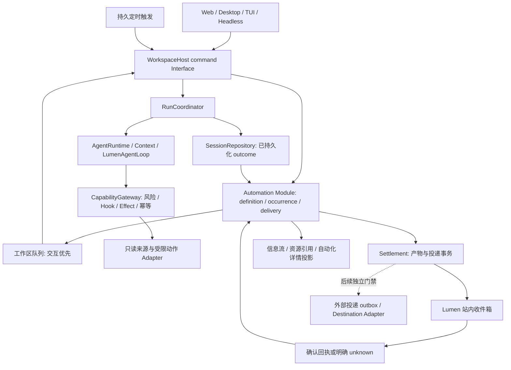

# Lumen v2 技术升级实施计划

日期：2026-10-20。状态：Proposed，已补充后端闭环复核；可作为 P0 实施输入，不是 Accepted 架构决策或运行验证。配套[产品与设计分析](research.md)、[交互原型](index.html)。后端约束以本计划为准，原型不证明实现；新增决策在实现阶段用契约测试验证，不要求每一步重复人工确认。

实施更新（2026-10-20）：此文件保留批准前的完整规划。v2.0 本地只读闭环与新 Web 界面已在生产源码实现；当前契约以 [Accepted v2 说明](../../docs/architecture-guide/16-personal-assistant-automations.md) 为准，实际验证见 [验收记录](../../docs/research/2026-10-20-v2-implementation-validation.md)。单机 OS owner 与站内事务简化了原提议中的 lease/fencing 和外部 outbox；未声称完成真实断电、账号连接器、持久审批、外部投递或 P4 全平台发布门禁。

审查更新（同日）：[代码审查](../../docs/research/2026-10-20-v2-code-review.md)确认排队启用、no_change 结果语义、静默设置和工具重名四项待修问题。当前不能认定闭环已全部完成；先修复并补反例回归，再进行真实 Provider 与发行验收。本文其余 Proposed 内容保留为原规划，不反向证明实现。

产品方向更新（2026-10-21）：后续实施改按[目标驱动与资料空间优化计划](../../docs/plans/2026-10-21-lumen-v2-product-flow-upgrade.md)推进。目标创建不再以文件、手写里程碑或自动化配置为前置；先补共同对象与关联工作流，再扩展受限后台研究。原计划的安全、持久化和发布门禁继续有效，新计划没有自动启用或迁移用户任务。

落地更新（2026-10-21）：上述四项问题已修复，目标／资料／讨论与受限来源研究已实现，见[本轮验收](../../docs/research/2026-10-21-v2-product-flow-validation.md)。本文件保留阶段规划；现行契约与发行限制以上述 Accepted 说明和最新验收为准。

## 1. 核心决策

保留 Adapter → WorkspaceHost → RunCoordinator → AgentRuntime → Context / Loop / Gateway 的依赖主线。增加一个拥有**自动化定义、触发实例和投递事务**的深 Module，通过 Host 命令调用现有运行时。Scheduler 只决定何时提交意图，不代替 Loop 思考，也不代替 Coordinator 持久化 turn。

首发为单用户、单机常驻 Host。采用本地 SQLite 保存自动化控制状态，遵循仓库已有持久 outbox 的实践；现有 Session append-only journal 继续拥有对话和 turn 事实。暂不增加 Temporal、DSH、Neo4j、Milvus、Kubernetes 或跨云工作流服务。

主要参考为 [Building effective agent automations](https://claude.dev/blog/building-effective-agent-automations/)，依据用户第二轮反馈收敛：Muse 提供信息架构参考，界面和动态形象继承当前 Lumen。以下持久事务设计是对 Lumen 源码约束的推导，不能当作该文章已经替我们解决的契约。原 design/ 中 Ontology 等资料只保留为历史背景。

## 2. 当前代码的真实边界

| 当前实现 | v2 必须尊重的限制 |
| --- | --- |
| `WorkspaceHost._start_run` 检查 `_active_run_id`、Live execution 与 `WorkspaceRunLock` | 同一个工作区现在不能任意并行执行多个独立 run；首版排队，交互任务优先 |
| `WorkspaceHost._requests` 记录 `(session_id, client_request_id)` | 它是进程内去重，不能用于证明重启后的 durable exactly-once |
| `CreateSession` 没有指定 identity，`SessionRepository.create()` 内部随机生成 UUID | 固定 Session identity 需要新增 Host 内部创建路径，不能把现有命令当作已支持 |
| `_start_run` 随机分配 run_id，但 journal v12 已存 `interaction_id` | 复用这个持久字段关联 occurrence；不能仅为 origin 假定必须升级 v13 |
| `_request_run_approval` 等待内存 Future，`_execute` 最后才释放执行锁 | 只读 Profile 也必须处理意外确认，不能让无人值守 run 永久等待 |
| `RunInput` 没有 per-run limits / Profile，Runtime 读取共享 `self.limits` 和 `_native_tools` | 需要 typed run execution context；不能修改全局配置模拟单次权限与预算 |
| `RunCoordinator` 持久化 outcome 后 Host 发布事件 | 自动化状态从已持久化结果推进；不能把 UI SSE 消息当成可靠队列 |
| `SessionRepository` schema v12 | 新自动化状态单独存储；不把大量来源数据写入 journal，不改写 v1–v11 |
| `MemoryManager` 是偏好与学习公共 Seam | 扩展可编辑偏好与来源视图；游标、投递、授权不进入通用 memory |
| `context/memory/extraction.py` 有 SQLite 队列和 lease | 可借鉴事务与恢复实践；不把记忆提取队列改成通用调度权威 |
| `ToolSpec` 分离 Risk / EffectKind / ToolConcurrency | 对每个来源和投递工具分别声明，后台执行不放宽权限 |
| `TaskWorkspace` 和 `CompletionGate` 校验 mutation、Effect、Agent 等 | 自动化的成功投影不能绕过这些门禁 |
| `RegistrationScope` 只拥有资源与后台 task 生命周期 | 在此启动、取消、释放 Scheduler task，不在 scope 中存定义或调度状态 |

## 3. 目标运行链路



图中 Automation Module 是新增控制权威，其他盒子为已有权威或提议的 Adapter。内部关系应直接保存在严格类型与外键中；无需为了画图再建一套通用 graph framework。

## 4. 最少的领域对象

| 对象 | 必要字段 / 约束 | 权威 |
| --- | --- | --- |
| `AutomationDefinition` | id、revision、owner_workspace_id、intent、enabled、schedule、timezone、sources、destination、notification_policy、explicit_budget、execution_profile、stop_condition | 自动化库；外部输入 Pydantic extra=forbid |
| `Occurrence` | id、automation_id、definition_revision、trigger_kind、local_edition_key、scheduled_at_utc、phase、result、session_id、interaction_id、lease、fencing_version、execution_snapshot_ref、outcome_ref | 自动化库；每个逻辑触发只有一个 occurrence，phase 与业务结果分开 |
| `SourceCheckpoint` | automation_id、source_id、connector_revision、opaque_cursor、read_status、candidate_checkpoint、verified_at | 自动化库；不让模型改写 authoritative cursor |
| `Delivery` | id、occurrence_id、destination_revision、payload_digest、status、provider_receipt_ref、attempt_count | 自动化库；同一逻辑投递重试复用同一 identity |
| `ReportedItem` | workspace_id、automation_id、destination_lineage、source_account_scope、stable_item_id、last_reported_revision、delivery_id | 自动化库；只有对应投递确认后才更新，不跨任务或账号去重 |
| `InboxItem` | occurrence_id、artifact_ref、kind、coverage、notification_decision、read_at | 自动化库投影；正文由 ArtifactStore / Work Product 持有 |
| `FeedEntry` | stable_id、origin_ref、kind、summary、resource_refs、coverage、created_at、read_at | Host 查询投影；任务与投递状态仍归原 Module，不由卡片写入 |
| `Idea` | id、reason、intent、provenance_refs、dismissed_at、started_session_ref | 首版规则建议及用户交互记录；开始只创建对话意图，不授权执行 |
| `SavedResource` | owner_workspace_id、canonical_resource_ref、saved_at | 跨 Session 引用索引；不复制正文，不扩大原资源读取权限 |
| `Goal` | id、title、confirmed_milestones、automation_refs、artifact_refs | 后续独立目标 Module；不替换 Plan 或 Session |
| `AssistantPreference` | 显式内容、scope、版本、provenance、候选 / 确认状态 | 基于既有 MemoryManager 的用户确认视图 |

不要把 `Goal`、`AutomationDefinition`、`PlanState` 合并：Goal 跨多次执行，Automation 是重复委托，PlanState 是某个执行过程中的计划。也不要再创造一个与现有 run 同义的 TaskRun，只需要 Occurrence → Session / run 的关联。

`execution_profile` 首发仅支持一个已验证的无人值守只读 Profile。它限制工具集合、工作区、来源范围及显式预算，不是第三套 permission policy。

execution snapshot 固定 definition revision、来源 lineage / 读取窗口、Profile 与有效工具指纹、模型配置、显式预算、偏好版本和 destination。凭据本身不进入 snapshot，只保存受保护的 credential reference 与授权版本。执行前获取当前有效凭据；变更不能静默切换到另一个账号。

信息流可以包含已持久化的结果、目标进展和待用户处理项；它读取各权威，不接管它们。首版 `Idea` 用明确规则和来源生成，保留“为什么推荐 / 不感兴趣”；只有真实需求出现后才增加模型推荐。收藏的唯一键为工作区与 canonical resource identity；取消收藏只删引用，删除产物仍走原 Work Product Interface。

## 5. 文件与 Interface 变更范围

下表是建议落点，实施时先检查已有 Module Depth，再按真实复杂度决定文件数量，不以表格为理由机械拆类。

| 落点 | 改动 | 必须一起覆盖 |
| --- | --- | --- |
| 新 `src/lumen/automation/` | 严格契约、一个公共 AutomationEngine、持久仓库与 timer 实现 | SQLite 事务、恢复、fake clock 测试；不公开无第二实现的 scheduler 抽象 |
| `application/models.py`、`host.py`、`application/__init__.py` | 定义命令、内部固定 Session / interaction identity 的 admission、一次执行 Profile | 持久 request identity、revision 冲突、意外确认退出、跨客户端契约 |
| `run_coordinator.py`、`runtime.py`、`agent_loop/loop.py` | typed run execution context，传递工具与 native tool 限制、单次预算；复用 prepare / commit 与原 Loop | 不污染交互 run；中断恢复、terminal 仅一次、预算不重置、人工继续 |
| `sessions.py` | 内部按预分配 UUID 创建 / 查找 Session，复用 v12 interaction_id；必要时补创建目录的耐久边界 | header 冲突拒绝、排他创建、创建与 journal fsync 故障注入；仅出现无法表示的新契约时另议 v13 |
| `tools/spec.py`、`gateway.py`、`registry.py` | 为实际来源与目的地注册明确风险、Effect、并发和幂等元数据 | Hook、unknown、审批、取消、Effect recovery |
| `context/engine.py`、`context/memory/*` | 构造有界自动化上下文，读取最新明确偏好、候选偏好展示 | provenance、敏感度、遗忘、跨工作区隔离、旧提取任务兼容 |
| `resources.py`、`lifecycle.py` | 装配 AutomationEngine；启动与关闭 timer / outbox worker | Host writer ownership、无阻塞 I/O、task 与资源完整清理 |
| `api/` | Host 命令的 HTTP Adapter、Feed / Idea / 资源索引查询与收藏操作 | auth、CSRF/Origin、OpenAPI、断线续订、稳定分页、引用权限与大载荷边界 |
| `src/web/src/components/`、`lib/api/`、`lib/state/` | 新导航与页面，复用 Composer、document-preview、turn-sources、useModalFocus | navigation、focus、loading / empty / error、移动端与 schema 类型 |
| `cli.py`、`headless.py`、`ui/`、`src/desktop/` | 最小一致能力；CLI 列表 / pause / run-now；桌面显示 Host 在线语义 | Default / Plan / TUI / headless 不能出现不同授权或状态结论 |
| `docs/commands.md`、架构指南、桌面文档 | 只在相关能力实现后写正式行为 | Atlas 手写图解与生成内容；当前蓝图不能直接改成已实现说明 |

最初的公共命令建议为 `CreateAutomation`、`UpdateAutomation(expected_revision)`、`ListAutomations`、`SetAutomationEnabled`、`RunAutomationNow(client_request_id)`、`GetAutomationOccurrence`。需要持久恢复的审批通过根 Host 原有的审批权威扩展，不建立独立“允许一切”入口。

同一 workspace 只由一个常驻 Host 持有自动化控制写权。启动时取得生命周期级 OS owner lock，执行仍另取现有 WorkspaceRunLock；执行锁不代表 Scheduler 领导权。其他进程可读，自动化写命令应连接 owner 或明确返回 owner_unavailable，不能偷偷启动第二个调度器。SQLite lease / fencing 保护陈旧任务提交，但不替代进程互斥，也不能撤回已经发出的外部请求。

## 6. 调度、时间与同工作区竞争

### 6.1 时间契约

- 用户选择 IANA timezone；同时存本地规则与计算出的 UTC instant。向模型提供本次 edition 的明确用户日期，避免服务器时区参与内容日期判断。
- 首发提供 daily / weekdays / weekly 三个结构化规则，与原型一致；通用 cron 编辑器不在首版必需范围。`zoneinfo` 使用平台 tzdb，Windows 缺失时通过已有依赖审计决定 `tzdata`，不得静默退回本机时区。
- 夏令时重复时刻只创建一个该 edition；缺失时刻采用明确并可测试的“移至下一个有效时刻”策略。定义变更时重新计算未开始的触发，不让旧 revision 继续创建未来任务。
- 保存 `last_evaluated_at` 与候选 due occurrences。通过唯一约束防重复，timer 只是唤醒器。不能只有 `asyncio.sleep()`，也不能依靠 Web 页面打开。
- 同一自动化默认不重叠运行。默认漏跑策略为合并补一次最近应完成的整理；提醒类任务超过定义的有效期则标记 expired，不补发过时提醒。
- timer 扫描范围与推进 `last_evaluated_at` 在同一事务中提交，先物化 occurrence / skip / expired，再推进扫描位置；补跑只保留最近一次，其余以 edition 范围记录被合并的原因。按有界批次扫描，历史积压不一次装入内存。
- 首发停止条件只支持明确结束时间、最大触发次数或用户停止；自然语言“直到目标完成”先作为建议，需确定性证据和明确契约后才能自动改变 enabled。

### 6.2 优先级与执行席位

保留当前 WorkspaceRunLock。人发来的新任务与 Live 工具调用优先，后台 due occurrence 进入 durable queue，获得席位后才进入 Host。`WorkspaceBusyError` 表示 admission 延迟，不是模型失败，不应触发 Loop model retry。

暂停阻止新的定时 admission，并将已 queued、尚未开始的触发标记 skipped(paused)；正在执行的 occurrence 可以结束。显式 RunNow 可在暂停状态创建一次人工触发，不重新启用定时。用户取消正在运行的 occurrence 时复用 Host CancelRun，保留已完成工具；UI 显示“正在停止”直到真实终态。定义归档保留历史与引用，硬删除不作为首版入口。

修改采用 expected_revision CAS：旧 queued 项 superseded，新未来触发重新计算；运行中项固定旧 execution snapshot，不把新指令混入半次执行。连接撤销是例外：后续来源访问与发布前立即复核，阻止新读取 / 发布，不宣称可撤回已读数据。每次取得席位后再次检查 enabled、revision、有效期、权限、验证指纹和预算，覆盖检查与启动间的竞争。

前台优先仅指 owner Host 内尚未 admission 的队列，不表示能抢占一个已在运行的后台 Loop，也不保证其他 CLI 进程之间的全局公平。后台必须有用户可见的有限请求 / 工具预算和执行时限；若前台被占用，显示取消或等待。外部进程持锁时按有界退避重试 admission，不持有 execution lock 等待、不增加 model retry。

首发后台不进入 `_PendingApproval.future` 等待。一次执行 Profile 只能缩小权限，仍调用原 ApprovalPolicy；即使只读工具因用户规则要求确认，也应在 Host 返回结构化拒绝并终止本次自动化为 needs_user_action，持久化后释放席位，不在模型中重复尝试同一请求。用户从前台显式继续，由正常 Host 审批路径处理；不将信息流卡片当作原工具的重放凭证。

真正支持邮件外发前，必须另外实现持久审批状态、内容 / 收件人 / revision / 到期时间绑定、一次性决定和受保护的 continuation。当前 Future、卡片与 SSE 都不能独立恢复执行；该扩展属于后续发布门禁。

### 6.3 本地桌面语义

前台窗口关闭但 Host 常驻时继续调度；退出进程、关机和睡眠时不执行。启动后读取 due 状态并应用漏跑策略。是否默认开启 macOS 登录项属于后续具体设置，不以此次原型授权替用户开启。

Web 当前只接受 loopback，是同一设备的界面；远程常驻 Host 需要独立身份、传输与权限设计，不能简单将 host 参数开放到公网。

### 6.4 草稿、试跑与启用

定义默认 draft / disabled。试跑是明确 `trigger_kind=trial` 的独立 occurrence，受相同 Profile、预算与审批规则限制；可生成标为试跑的预览，但不推进正式 SourceCheckpoint / ReportedItem、不发系统通知、不执行外部动作。没有正式 checkpoint 时，创建时明确初始读取窗口，不能默认扫描全部历史。

成功试跑产生 validation receipt，绑定 definition revision、来源账号 / scope / 查询范围、Profile、工具与模型配置版本及用户确认偏好指纹。启用命令用 expected_revision 检查成功 receipt 与当前指纹；在启用事务和每次 admission 都复查。指令、来源、目的地、预算或授权变化会失效；连接恢复后旧 receipt 不自动复活。定时重复运行并不每次要求重新试跑，但有效 Profile / 授权变化必须先停用再验证。

Create / Update / Enable / Pause / RunNow / Trial 命令都有持久 request key、payload digest 和 revision 校验；响应丢失后重试返回原结果。启用只生成下一次未来触发，试跑期间过去的时间不被视为应补跑。编辑默认 disabled 并保留旧 revision，避免 UI 保存修改就立即运行。

## 7. 防重复与跨存储崩溃边界

### 7.1 触发去重

定时 occurrence 唯一键使用 `(workspace_id, automation_id, trigger_kind, local_edition_key)`；首发 daily / weekdays / weekly 每个本地日期最多一份 edition，存对应 UTC instant，revision 不进入唯一键。改时间后不能在已经执行过的 edition 再触发，时区修改只从修改后的未来候选生效。RunNow / 试跑使用 `(workspace_id, command_kind, client_request_id)` 和规范化 payload digest；相同请求返回原记录，不同 payload 复用 key 返回冲突。用户明确“再运行一次”才生成新 request key。

SQLite 内通过唯一约束与事务完成 due → queued → claimed；持有 workspace writer 身份的 Host 才可启动执行。过期 lease 可以接管，但每次关键提交都检查 fencing version，旧 worker 不可提交。模型主请求的 retry 继续只由 Loop 管理。

### 7.2 occurrence 与 Session journal 不在一个事务中

admission intent 在自动化库先提交固定 Session UUID、interaction UUID 和 execution snapshot，再由 Host 内部创建 / 查找该 Session。通过 v12 已有的 interaction_id 查询 running / checkpoint / terminal；Host 启动新 turn 时使用预分配 identity，`persist_run_start` 必须先于 create_task。自动化库的唯一映射拥有 origin，不要求在 journal 再写一份新事件。普通 CreateSession / StartRun 的公共默认行为不变。

此处需要真实代码改动：现有 SessionRepository.create 不接受指定 UUID，Host 也随机生成 run_id；应在原深 Module 中增加受保护的内部参数和冲突检查，不允许普通客户端任意注入 run_id。Session 已存在但 header / 所有权不匹配时拒绝，不覆盖。现有 `_requests` 不是恢复依据。

实施前写出所有 kill points 的对账规则：

| 崩溃位置 | 恢复动作 |
| --- | --- |
| 保存 occurrence 前 | 下一轮 timer 仍可创建，唯一约束去重 |
| occurrence 已存、Session 未创建 | 按固定 Session identity 创建 |
| Session 已创建、绑定未存 | 用 admission intent 中固定 UUID 检查 header 并补齐绑定，不再创建 Session |
| running 已持久化、task 尚未启动 / run_id 未回写 | 用预分配 interaction_id 对账；没有终态则 interrupted，不自动重跑 |
| turn 已持久化、UI terminal 未发布 | 从 journal 重建 occurrence outcome 与可重放事件，terminal 最多一次 |
| 外部 action 有 prepared receipt、没有确认 | 对账 / 人工处理，禁止透明重放 |

重启恢复顺序为：取得 owner lock → 打开并检查各存储 → 对账 admitting / running / settling 与未完投递 → 处理漏跑 → 开始新 admission。不能先消费 due queue 再发现上一轮未提交。P1 不自动续跑失去进程的 running turn；保留 checkpoint、partial outcome 和 Effect，要求用户显式继续。继续使用新的 execution attempt identity 并累计同一 occurrence 已花预算；unknown Effect 仍由原恢复门禁阻止动作。

仅给 StartRun 一个 client_request_id 不足以解决这些问题。P0 默认复用 schema v12；只有新增严格数据无法由现有字段和自动化库表达时，才单独评审 schema 升级。文件级 fsync 已存在，Session 首次创建目录项的耐久性仍需平台故障实验，不能把“进程被 kill”测试等同于断电验收。

### 7.3 投递事务

站内收件箱以 `UNIQUE(occurrence_id, destination_revision)` 插入，正文引用 ArtifactStore。写 inbox、确认 delivery、更新 reported items 与相应 checkpoint 在同一自动化库事务中完成，具备本地原子边界。

事务前先通过 ArtifactStore 写入并确认正文，保留可重放、严格校验的 settlement manifest（coverage、item dispositions、候选 cursor、artifact digest）。只有这个 manifest 与 journal outcome 能重新导出相同提交时才进入 settling。artifact / manifest 缺失时阻止成功与 checkpoint 推进；事务失败后重试同一 settlement，不重新请求模型。无引用的孤儿 artifact 可后续清理，但 GC 必须把自动化 manifest / inbox / 收藏作为保留根。

P1 只允许一个站内 destination，confirmed 代表站内记录已持久可读，不代表用户读过或系统通知已出现。Feed、资源索引和系统通知是投影：写 durable projection event / notification outbox 后独立重建或消费，推送失败不回退来源游标，也不触发第二次模型执行。操作系统通知不作为业务送达权威。

外部投递使用 outbox：prepared → sending → confirmed / unknown / failed。发送前保留 payload digest、目的地与授权摘要，发送后存 receipt / readback。未知不自动重发；服务端支持幂等键时复用，支持查回时回查，否则停在 unknown 等人工处理。不要承诺第三方 exactly-once。

投递标题或日期相同只能作为辅助检查，不能当作可靠的幂等凭证。

### 7.4 状态推进与失败处置

`Occurrence.phase` 只描述控制流程：queued → admitting → running → settling → settled；尚未运行的 skipped / expired / blocked 可直接进入 settled。业务 `result` 单独保存 complete / no_change / partial / needs_user_action / blocked / failed / cancelled / interrupted / budget_reached / skipped / expired，Delivery 再单独描述投递状态。不得将所有 settled、run completed 或 artifact 已存在都映射为成功。下表为正式执行，trial 的提交限制始终按第 6.4 节，不写正式 cursor。

| 情况 | 必须持久化的结果与后续行为 |
| --- | --- |
| 完整且有新结果 | journal terminal + 验证 manifest 后原子提交站内结果、dispositions 与 cursor；complete |
| 所有必要来源完整且无变化 | 内部 no-change receipt + 安全 cursor 提交；no_change，不生成普通提醒 |
| 部分来源成功 | 带 coverage 警告的 partial；只有满足第 8 节条件的来源推进 |
| 永久权限失败 / 连接撤销 / 意外审批 | blocked 或 needs_user_action；停用后续 admission，去重显示待处理事项；用户修复后试跑再启用 |
| Provider / 只读来源暂时故障 | Loop 管理模型重试，Adapter 管理有界只读 HTTP 重试；耗尽则 failed，不由 Scheduler 重放整次 run；下个正常 edition 才再尝试 |
| 取消 / 执行时限 / 用量预算 | 先存 typed stop reason，再通过原 Coordinator 落终态；cancelled 或 budget_reached，保留 partial，不推进正式来源 |
| running 进程丢失 | interrupted，保留原 interaction 与 checkpoint；人工继续检查余量与 Effect，不透明重放 |
| outcome 已存但 settlement 未完成 | 只重试同一 settlement，保持 settling；不占模型执行席位，不再请求模型 |
| 外部送达 unknown（后续功能） | 保持未完成 settlement、阻止该自动化下一轮推进；回查或人工裁决，禁止自动重发 |

每个推进都带当前 phase / version CAS 与 owner fencing。相同 settlement 重复提交返回原 receipt；冲突 payload 进入可见故障，不能覆盖事实。同一自动化在上一轮 settlement 已安全结束前不开始下一轮；模型执行席位在 journal terminal 后释放，其他自动化和前台仍可运行。一个坏任务 / 坏 Session 不应导致全部 Scheduler 崩溃。

取消、超时与完成竞争时，以 Coordinator 已持久化的 terminal 为 run 事实；停止请求不是取消成功证据。不能在 complete 已落盘后仅因迟到的取消请求将结果覆写 cancelled，也不能发布第二个 terminal。

结果候选使用严格 `AutomationResult` manifest，而不是从最终 Markdown 猜成功：artifact refs、关联 read receipt / item ids、来源处置、结果类别和待处理项都由确定性验证器检查。RunCoordinator 继续拥有 run terminal；AutomationEngine 在其后拥有业务验收。被 CompletionGate 拒绝、无真实 read receipt、缺 artifact 或来源不匹配的结果只能失败 / 待处理，不能通过卡片文案绕过。

## 8. 来源、游标与结果真实性

每个来源 Adapter 需返回结构化 read result：source identity / revision、读取窗口、稳定 item ids、分页完整性、candidate cursor、失败类别和用于引用的原始链接。模型可以筛选和摘要，不拥有 checkpoint 写权。

第一版为每条 occurrence 保留候选读取数据，直至必要结果已持久送达再推进对应 checkpoint。cursor 按 opaque token 比较版本，不猜字典序；提交采用旧 checkpoint version CAS。账号、scope、查询范围或 Adapter 版本改变时创建新 source lineage 并重新验证，不继承不相容游标。失败 / 未完成分页的来源不推进；其他完整成功来源只有在该来源所需条目都有持久处置记录时才独立前进。带重叠窗口与稳定 ID 去重以处理迟到和乱序。

读取进度与已报告语义分开：每个已读候选必须是 reported、明确 suppressed（保存规则与原因）或持久 deferred。重要性不足而未展示的条目不能标为已报告；deferred 必须在下次处理或有明确到期处置，不可只推进 cursor 后丢弃。首发结果验证以 Adapter 的 typed read receipt 为 coverage 权威，模型只能引用这些 receipts 中的 item ids，不能自己宣称来源已读完。

无新内容的运行也写一个内部 no-change receipt，证明已读取并作出静默决策，再推进来源状态。不要因为没有对外通知就每次从同一个 cursor 反复抓取。

no-change 要求全部必要来源读取完整、没有待处理变化且停止条件未要求提醒；缺来源、工具未被调用、分页中断或摘要失败都不能记为 no-change。部分成功可投递带覆盖警告的简报，occurrence.result 仍为 partial，只有已完成处置的完整来源可推进。完全失败、取消、预算停止和 needs_user_action 不推进来源；它们的错误提示是操作提醒，不是成功简报。

发布前重新读取需要行动的项目状态。已解决或无法确认的条目不写成“仍需处理”；链接采用源记录给出的原始 URL。一次结果应同时带 coverage、cuts 和 artifacts refs，UI 可直接解释为什么没有日历信息。

读取的邮件、网页与 MCP 结果是低信任内容，不能改变 destination、连接范围、用户偏好或批准策略。后续连接先实现一个真实只读来源 Adapter，使用 HTTP MockTransport 验证分页、权限和参数；不能把演示的三个连接图标当作完成集成。

## 9. 个人助理上下文与隐私

复用 MemoryManager 中 USER / PROJECT / PATH 范围与显式 / 观察 / 推断来源。每次 occurrence 重新读取当前确认偏好，记录 preference revision；任务自己的 intent / stop condition 单独版本化。低信任推测只能成为候选；不能自行把“你常常确认邮件”学习成“以后自动发送”。

自动化上下文包含：明确目标与当前 definition、来源范围、最近相关的有界 ledger 摘要、本次 checkpoint、用户偏好、尚未解决的 blockers。按需打开正文，避免重复注入所有历史、Skill、MCP 文本和 memory。

OAuth token / API key 优先复用现有 credential Seam：`mcp_oauth.py` 已有 `JsonCredentialStore`，MCP 的 streamable_http 也已有 OAuth 支持。新增邮箱/日历等个人应用 Adapter 时，补齐其各自的 scope、刷新、失效和服务端撤销语义；删除本地 token 不等于服务端权限已撤销。首发不宣称具备 Claude 文章示例的网络代理凭据注入或 Muse Secure VM。若后续需要无明文凭据执行，必须实现真实的 out-of-process broker，而不是在提示词里写“不要看密码”。

保留现有 scope 语义：USER 偏好有意在同一 OS 用户的项目间共享，PROJECT / PATH 按 canonical project identity 过滤。后台默认只读当前项目与用户明确写入的 USER 偏好，不把其他项目来源或推测隐式升级为全局事实；不能声称 USER 本来就是 workspace 隔离。连接、来源正文、资源引用与授权始终按所属 workspace / account scope 校验，私人空间也不跳过 Sandbox。数据导出/遗忘须分别说明偏好、历史、产物与投递凭证范围。

## 10. 权限、预算、通知

| 控制 | 实现方式 | 用户可见表现 |
| --- | --- | --- |
| 读取范围 | Connector scope ∩ Tool registry ∩ execution profile ∩ Workspace mode | 创建时列出来源；连接失效后明确标记 |
| 高风险动作 | Gateway 原有 Risk 审批；需要逐次审批的动作不能被 automation 放宽 | 具体对象、内容、范围、拒绝 / 本次确认 |
| Effect | canonical receipt + TaskWorkspace completion / reconcile | 结果生成、动作发生、结果验证分别表达 |
| 预算 | 必填有限 request_count / tool_calls / occurrence 时限，按单次执行上下文传入原 Loop；成本单列估算 | budget_reached 独立原因，保留已完成结果；不改交互 run 默认预算 |
| 未知价格 | 根据 Provider 目录与计量能力报告未知；不可把估算当账单 | 显示费用未知或另用请求预算；不伪称硬美元上限 |
| 通知价值 | 确定性去重、状态变化、用户偏好，再用模型建议优先级 | 默认只有 meaningful change / completion / failure / needs user action 才提醒 |
| 免打扰 | 用户时区规则与投递队列；紧急例外需用户明确配置 | 静默积累到信息流，不自动越过夜间限制 |

对外自动发送在首发范围外。要让用户授权某个固定通道自动投递，必须显式设计持续授权与撤销契约；不能直接将 auto 模式或 Skill 当持续授权。commit / push 永远保留根 Host 每次新审批。

后台 Profile 通过既有 Gateway narrowing / guards 只授予显式 allow-list 中 `Risk=read` 且 `EffectKind=observe` 的能力，并在执行时校验 connector scope；unknown / mutation / 命令执行不因名称像“读取”就放行。首发禁用 Provider native tools、Live、多 Agent / delegation；它们不全经过同一 Gateway，后续需分别证明权限和合计预算。必要的结果落盘由受限的 Host settlement 写 ArtifactStore / inbox，不给模型任意文件写权。

当前 RunInput 没有这些参数，需要新增 immutable execution context 从 Host → Coordinator → Runtime / ModelDriverRequest 贯通，限制每次实际请求而非只隐藏工具列表；退出和取消不能污染下一次交互 run。首发关闭自动化 Session 的自动标题、自动记忆提取和模型推荐，避免未计费的附加请求；用户需要时再显式纳入预算。请求数沿用 Loop 的 logical request 定义，transport / output-limit retry 仍归 Loop 并单独计量；费用没有可验证上界时不声称硬美元预算。时限由 Host 取消原 run 并等待 Coordinator 落终态，不能只给 await 包 timeout 就释放锁。恢复 / 人工继续沿用剩余预算，不重置限额。

预算恢复首版采用保守 reservation：admission 前从 occurrence 余量中持久预留本 attempt 的有限请求 / 工具额度，再将额度传入 Loop；终态 usage 可证明未使用时才释放余量。进程崩溃、请求已发但 usage 未落盘时，保留该预留而非当作零消耗。没有可证明余量就禁止继续，用户可明确追加预算后开始新的 attempt；不能凭重新加载 Session 自动获得整份额度。绝对执行截止时间也保存在 snapshot 中，重启不重置时钟。

## 11. UI 实施顺序与组件复用

1. 默认保留对话欢迎页，为现有 LumenApp 增加“对话 / 信息流 / 灵感 / 目标 / 资源库”主导航；自动化为辅助入口，偏好和连接进入设置。延续当前 globals.css、原 Logo、字体、输入框和黑色按钮；是否采用路由取决于深链和历史需求。
2. 信息流读取 Host 提供的 FeedEntry 与 attention / outcome / upcoming 投影，支持主题、收藏与继续讨论；不在浏览器解析 raw history 推断状态。主题设置不屏蔽待审批事项；分页需要稳定游标，历史 coverage 不随连接恢复被改写。
3. 灵感显示理由与来源，支持分类、忽略、恢复。每次开始都向对话恢复该条意图；搜索中打开后关闭搜索层。后续创建自动化仍经过明确草稿、试运行、确认与启用，不将“开始灵感”当后台授权。
4. 资源库复用 document-preview、turn-sources 与 Work Product Interface；搜索、类型筛选和收藏均使用 canonical reference。信息流收藏和资源库共享同一索引，正文不重复存储。
5. 自动化表单输入 name、intent、sources、schedule、timezone、destination、notifications、budget；保存草稿后使用独立 TrialAutomation，展示覆盖与结果，再启用。RunNow 是正式人工触发，不能冒充不消费游标的试跑。修改来源、目的地、授权、预算或指令时使相关验证失效。详情使用 useModalFocus / 既有抽屉模式。
6. 个性化偏好在设置中显示 scope、provenance、source kind 与候选状态，用户提交仍走 Host command。没有独立“记忆”导航。Goal 初期明确标记未接入状态，第二阶段接入真实里程碑与引用，不把模型估算当已完成。
7. 复用现有 MascotScene / VideoMascotRenderer、idle/react 视频、poster、visibility 和 reduced-motion hooks。无需重新制作形象；动态实例仅用于欢迎页，活动缩略图用原 poster。换页清理播放器，列表不批量开启解码器。
8. 复用当前焦点与滚动模式：更新收藏或筛选后保持触发控件焦点，内容消失时回到 main；移动端导航关闭后不可聚焦隐藏控件。模型生成内容、错误、加载、无结果和部分来源都需单独状态。

当前原型不是生产迁移补丁。其 localStorage、示例凭据状态、同步“试运行”和伪数据必须在接入 Host 时移除，不可复制到 API 权限逻辑中。

## 12. 分阶段可交付计划

以下为 **2 名熟悉仓库的工程师 + 设计/测试兼职支持、约 10—14 周** 的规划假设，不是承诺；实际在 P0 契约实验后重估。真实 OAuth、平台常驻进程与持久审批可能延长周期。

| 阶段 | 预计投入 | 交付 | 退出条件 |
| --- | --- | --- | --- |
| P0：确定契约 | 第 1—2 周 | Proposed ADR、owner / admission / v12 identity 实验、typed execution context、试跑指纹、状态与 settlement 契约 | 第 17 节 P0 反例全部有契约测试；证明 Profile 缩权不污染交互；完成 kill-point 实验后才承诺工期 |
| P1：本地可靠闭环 | 第 3—5 周 | 单 owner、定义 / 试跑 / 启用、结构化 schedule、队列、单一真实只读来源、站内 inbox、恢复与投影重建 | 重启不重复触发；来源失败不跳 cursor；暂停清理 queued；意外审批释放席位；有限后台预算；通过相应断电耐久实验后才宣称断电安全 |
| P2：新 UI Beta | 第 6—8 周 | 对话、信息流、规则灵感、资源库；辅助自动化管理；设置内偏好和连接；复用现有动态狐狸 | 对话→草稿→试跑→启用→结果进入信息流→收藏到资源库可完成；移动端、焦点与 reduced-motion 检查通过 |
| P3：个人助理扩展 | 第 9—11 周 | 目标、来源扩展、只读日历/邮箱、用户确认偏好；需要时才做持久审批 | 真实账号 scope / refresh / revoke 验证；跨 Session 数据隔离；确认前不外发；等待审批不堵塞前台 |
| P4：发布收敛 | 第 12—14 周 | 全量迁移、恢复矩阵、灰度默认关闭、打包与说明 | CI 多平台通过；轮换/撤销/升级/降级已演练；真实 Provider smoke 与选定 Connector 验收 |

v2.0 可以在 P2 的可靠只读闭环成熟后发布，不必等所有 P3 功能才创造价值。邮件外发、Webhook 和远程 Host 使用各自的独立退出条件；不把可选功能拖成首发阻塞。

## 13. 测试矩阵：先证明异常也能解释

| 范围 | 最小必须证明 |
| --- | --- |
| Schedule | 用户时区、DST 缺失 / 重复、时钟跳变、休眠漏跑、变更 revision、重复 timer tick、重复 RunNow |
| Queue / admission | 前台优先、同工作区锁、多 Host 争抢、过期 lease、旧 fencing token、取消与暂停的竞争 |
| Crash recovery | 每一个第 7 节 kill point；journal 已写但 automation 未写；artifact 已存但 inbox 未提交 |
| 来源 | OAuth 过期、权限撤销、分页中断、429 / Retry-After、同时间多 item、迟到项、读取失败与无变化区分 |
| 投递 | 发前崩溃、发后响应丢失、receipt 重复、回查成功 / 不支持回查、unknown 不重发、无变化内部 receipt |
| 审批 | content / recipient / revision 绑定、过期、拒绝、重启、多个客户端重复确认、子 Agent 无扩大权限 |
| 记忆 | 显式与推测分离、冲突与遗忘、敏感数据、当前指令优先、偏好版本变化 |
| Completion | 未验证 mutation、unknown effect、未结束 Agent、待导入 / 审批、缺 evidence 都不能成功 |
| 客户端 | loading / empty / partial / offline / budget / unknown / needs action，分页与 SSE 恢复，焦点与窄屏 |
| 信息组织 | 稳定 Feed 分页、历史 coverage 不变、待审批不会被主题隐去、跨 Session 资源访问权限、收藏唯一性、忽略与恢复建议、重开建议恢复原意图 |
| 定义生命周期 | 试跑不消费正式 cursor；修改后不能使用旧验证；启用响应丢失不重复；暂停 queued / 运行中 / 手动 RunNow 语义；同一 edition 改时间不双跑 |
| 后台执行 Profile | native tools / child / unknown capability 被拒绝；Risk=read 仍需确认时退出；撤销与 admission 竞争；后台退出后交互权限和预算不变 |
| 预算 | 有限请求、工具与时限逐项有效；附加模型工作被禁用或计入；继续不重置余量；无美元硬限额时明确显示估算 |
| Settlement | partial / no-change / suppressed / deferred 区分；cursor CAS；artifact 缺失与落盘后事务失败；多个 settlement 重放不重复；投影 / 通知故障不重跑模型 |
| 常驻与存储 | 两 Host 只一个 Scheduler owner；owner 丢失先恢复后调度；磁盘满 / DB 锁忙 / journal 损坏 fail closed；单任务故障隔离；长时间运行超过 10000 次请求不靠重启继续 |

实现阶段按仓库要求执行：

```bash
uv run ruff check .
uv run pyright
uv run pytest tests/test_workspace_host.py tests/test_web_api.py
uv run pytest
pnpm --dir src/web test
pnpm --dir src/web typecheck
pnpm --dir src/web build
uv run python -m lumen.contracts --write
uv run python -m lumen.contracts --check
pnpm --dir src/web api:schema
pnpm --dir src/web api:schema:check
```

增强提取和实时语音回归显式使用 `uv run --extra web --extra live pytest`。CI 质量任务不装可选 extra，所以核心导入不能无条件依赖它们。schema check 会与 Git 比较，预期生成差异也必须审查，不能把命令非零都当代码失败。

若改 Provider 请求或费用计量，加目录 / reasoning / models / Driver / Loop 请求级与 HTTP MockTransport 检查。改架构指南后重建 Atlas 并检查手写 index 图解；改打包则先构建 Web，再 uv build，隔离环境执行 wheel 中的 `lumen --version` 与 `lumen --check-config`。fixture 或 MockTransport 不代表真实 Provider、Connector 或性能验收。

## 14. 迁移、开关与回退

- 当前配置保持 v2；新增字段若只是兼容扩展，以严格契约明确 defaults。需要不兼容变更时单独评审，不能因为产品叫 v2 就随意把配置升版。
- 不自动把历史聊天推断为自动化，不自动打开连接或后台执行。已有 Session 和 Work Products 原样可读。
- Automation DB 自身有版本与事务迁移；迁移前备份。Session 如需 v13，v1–v12 仍可加载、升级只追加 schema_upgrade；旧版本二进制对新事件是否可读必须明确，不能承诺任意降级。
- 首次启用显示范围、时间、时区、运行位置、漏跑、预算和结果去向；来源不可用时不能直接启用。
- 发布开关控制新任务创建与 timer admission；关闭开关停止新触发并展示只读历史。正在执行的 run 通过原 CancelRun / recovery 路径处理，不删库“回滚”。
- 新导航在 UI 开关后启用；沿用原标志、主题与 renderer，不迁移或替换形象资产；不删除 TUI / headless / Default / Plan 路径。

### 14.1 常驻存储、投影与故障运行手册

- 自动化库放在现有用户状态目录下的 workspace 专属位置；workspace identity 区分不同 checkout，不能只复用会共享给 worktree 的 project_id。绑定实际 workspace 与 Session store identity；复制项目、换 Session 目录或恢复到新位置时默认不启用旧定时，先显式重新绑定，防止复制两份都执行。
- SQLite 打开时启用外键、明确 durability 设置、有限 busy_timeout，并通过 `run_io` / 单一存储执行器避免阻塞 async loop。DB 锁忙可在同一控制操作上有界退避；磁盘满、损坏、权限错误停止新 admission 并保留可读诊断，不重建空库继续调度。迁移、备份与 WAL 必须使用一致性边界，不能只复制一个正在写入的 db 文件。
- close 顺序：停止 timer / 新 admission → 取消或等候正在执行的 run 落盘 → 停止 settlement / notification worker → 关闭存储和连接 → 释放 owner lock。超时与强杀留下可恢复状态，不能在旧 run 未清理时让新 owner 同时执行。
- Host `_requests` 目前 10000 容量限制、`_runs` 回收和进程内 EventJournal 都不满足常驻历史查询。自动化 durable admission 使用自己的映射绕开内存历史容量依赖；保留普通交互去重契约，不能简单清空 `_requests`。API 从持久业务投影查询历史，SSE 只是唤醒，客户端断线后以 durable sequence 续读 / 全量对账。
- 这个 admission 扩展仍进入原 `_start_run` / Coordinator / Loop；对 automation origin 使用持久记录查询与响应投影，而不是把全部自动化 identity 再塞进 `_requests`，也不创建第二套执行器。停用、删除或恢复绑定 Session 的命令必须检查运行 / settlement 引用：未结束时拒绝硬删除；已结算的历史按保留策略处理，不丢失防重复证据。
- Feed 的只读状态、bookmark、Idea dismiss / start、Goal milestone 各有明确用户状态存储与 Host 命令，不能由 UI 改自动化表。首版 FeedEntry 是 inbox / 操作事项 / 已支持 goal 的查询投影；cache 可重建，稳定 id 不随重建改变。资源失效返回 unavailable / tombstone，不把权限失败显示成“未生成”。
- 历史 Delivery 固定原 artifact digest 与来源版本，后续编辑资源创建新版本，不能反向改写“当时送达了什么”。收藏跟随 canonical resource identity，打开最新版与查看历史投递版本要明确区分；每次打开仍校验 workspace 归属与资源权限。
- 不清理仍被 journal、Effect、未完成 settlement、Inbox、收藏或 Goal 引用的 artifact。P1 不引入自动永久删除；显式删除先审计引用，必要时保留 tombstone。备份恢复必须验证 DB 所引用的 Session / artifact 同一批次可读，缺失时 blocked，不能靠再次执行“修好”。
- 提供 Host status / CLI inspect：owner、下次触发、队列年龄、最后成功、partial / blocked 原因、unknown 与存储错误。原因码结构化且去敏；默认日志不含正文、token 或完整源 payload。新任务启动和失败投影都有耐久序号，不用定时弹“仍在运行”制造噪声。

## 15. 发布验收与风险排序

| 优先级 | 风险 | 必须拿到的证据 |
| --- | --- | --- |
| P0 | 重启或超时导致重复外部动作 | 故障注入中无透明重放；unknown 可核对；每次逻辑投递 identity 一致 |
| P0 | 没有最新偏好或来源权限却继续执行 | 每次 admission / tool call 校验；撤销后未再读取，敏感内容不出现在日志与 fixture |
| P0 | 假成功或游标跳过丢消息 | outcome / coverage / delivery 分离，事务与 checkpoint 回放测试 |
| P1 | 后台占满前台，等待审批卡死工作区 | fake clock 与并发取消 / admission 测试、真实交互检查 |
| P1 | 用户误解关闭应用仍运行 | Host 状态、运行位置、休眠提示和漏跑记录的可用性测试 |
| P1 | 跨项目私人上下文泄漏 | workspace identity 与 memory scope 隔离测试 |
| P2 | 通知过多、成本高而价值低 | 小规模真实使用收集有效性反馈，显式预算与静默策略 |

发布目标：故障矩阵中越权成功与重复外部投递为零；每个触发都有唯一 occurrence 或有原因的 skip / expired；每个成功结果可定位原始来源和 receipt。有效完成率、恢复率与成本先记录真实基线再设运营阈值，不虚构数字。

建议口径：有效完成率 = 有可验证结果且满足 delivery policy 的 occurrence / 应执行且未取消的 occurrence；来源覆盖率 = 成功覆盖来源 / 本次要求来源；通知无用率 = 用户标为不需要的通知 / 已展示通知；成本按每个有效 occurrence 归集已知模型、工具和执行费用，未知部分单列。

## 16. 这次已完成与未实施

已完成的是源代码与参考资料分析、现有动态形象接入、Muse 信息架构下的 Lumen 风格可点击原型、分阶段技术方案及 23 项原型自检。原播放器相关 22 项测试通过；当前生产源码未改。该目录没有实现 Scheduler、新的个人应用 OAuth Adapter、真实后台 run、持久审批恢复或通知发送，不能用演示交互作为生产验收。

## 17. 后端闭环复核结论与 P0 反例

复核结论：**上一版是完整方向稿，但没有达到可直接照表实现的后端契约闭环。** 本次补齐以下断点；现在首发只读闭环在设计层面有明确权威、失败出口与恢复规则，仍须由 P0 实验和 P1 故障测试证明。真实外发、可恢复审批与远程 Host 继续独立设门禁，不能用只读首发的验收替代。

| 原缺口 / 优先级 | 源码依据 | 本计划的最终决策与必须通过的反例 |
| --- | --- | --- |
| 固定 identity 只是文字假设 / P0 | [CreateSession / StartRun](../../src/lumen/application/models.py)、[Host admission](../../src/lumen/application/host.py)、[journal 创建与 interaction](../../src/lumen/sessions.py) | 预分配 UUID、受保护内部创建、复用 v12；在 Session 创建后、running 追加后分别 kill，重启不能新建第二个 Session / turn |
| 只读也可能永久等审批 / P0 | [Host `_request_run_approval` 与 `_execute`](../../src/lumen/application/host.py)、[Gateway 审批](../../src/lumen/tools/gateway.py) | 后台无 Future 等待，typed needs_user_action 落盘并释放席位；模拟 read 工具要求确认，前台随后仍可运行 |
| Profile / 单次预算没有传递路径 / P0 | [RunInput](../../src/lumen/run_coordinator.py)、[Runtime limits / native_tools](../../src/lumen/runtime.py)、[LoopLimits](../../src/lumen/agent_loop/loop.py) | immutable context 贯通；禁止 native / child、有限用量；后台被取消后交互工具和默认 limits 不变 |
| 执行锁被误当 Scheduler 领导权 / P0 | [WorkspaceRunLock](../../src/lumen/application/run_lock.py)只在执行期间持有 | 单 owner 生命周期锁；启动两个 Host 只有一个 timer / outbox writer，owner 退出后先对账再 admission |
| 修改、暂停与重复请求的竞争 / P0 | [Host `_requests` 与 `_start_run`](../../src/lumen/application/host.py)为进程内状态 | 所有控制 mutation 持久 key + digest + CAS；修改时旧 queued 失效，暂停时旧 queued 不启动，相同 edition 改时间不重复 |
| 试跑可能吃掉正式数据 / P0 | 当前没有 automation / trial 实现，原型“成功”不是后端契约 | trial 独立、不推进正式 cursor；试跑后首次定时仍读取正确窗口；撤销 / 重连或改定义使验证失效 |
| run 完成与业务结算混同 / P0 | [Coordinator terminal 持久化](../../src/lumen/run_coordinator.py)、[ArtifactStore](../../src/lumen/context/artifacts.py) | typed manifest、可重试 settlement；artifact 写完后 DB 提交失败，只提交一次 inbox，不再请求模型 |
| 无变化 / 部分覆盖导致跳游标 / P0 | 当前工具输出不能天然提供新来源的 receipt / cursor 契约 | typed read receipt + dispositions；一来源分页失败不推进该 cursor，未展示的重要候选 deferred 不丢失，缺来源不能 no_change |
| 记忆隔离描述与现状冲突 / P1 | [MemoryRecord USER 语义](../../src/lumen/context/memory/records.py)、[MemoryManager scope 过滤](../../src/lumen/context/memory/manager.py) | 保留显式 USER 共享，PROJECT / PATH 隔离；A 项目私有来源不得由 B 项目自动化召回 |
| 常驻历史 / 查询 / 删除缺口 / P1 | [Host `_reap_runs` / 10000 上限](../../src/lumen/application/host.py)、[内存 EventJournal](../../src/lumen/application/events.py) | 业务历史与请求映射耐久；超过 10000 次自动化 admission 不依赖重启，断线可重建 Feed，删除不能破坏未结算引用 |

P0 完成条件不是“表中对象都建好了”，而是上述 P0 反例已在真实 Host / Coordinator / Repository 组合中通过。测试可用 fake clock、fake ModelDriver 与可控只读 Adapter，必须穿过实际 Gateway 和 journal，不能只 Mock AutomationEngine 后宣称恢复成功。P1 再使用一个真实只读来源与真实 Provider 做小范围验收；暂不承诺工期和发布可靠性。

当前本次只修改计划文档；未实现或运行上述后端契约测试。此前 23 项原型自检与 22 项播放器测试不属于本节闭环证据。
