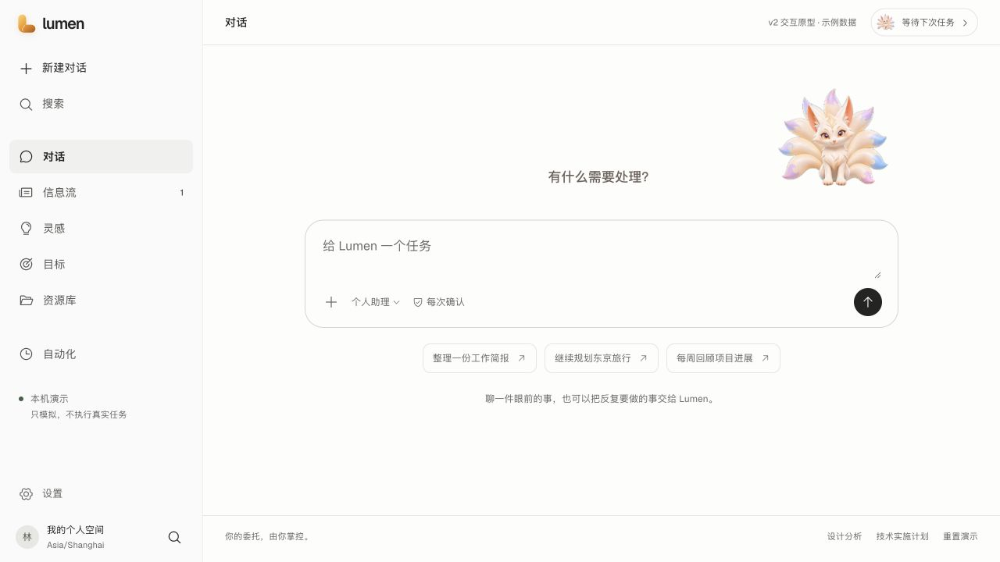
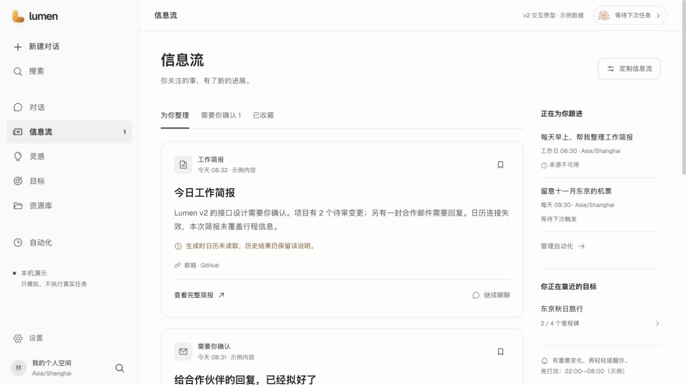
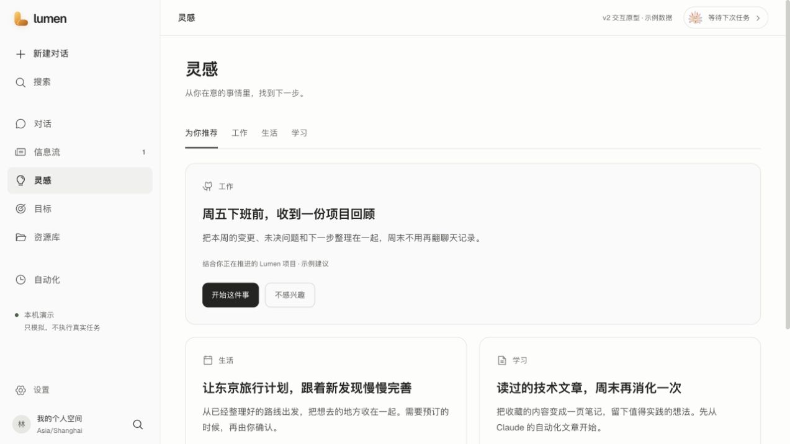
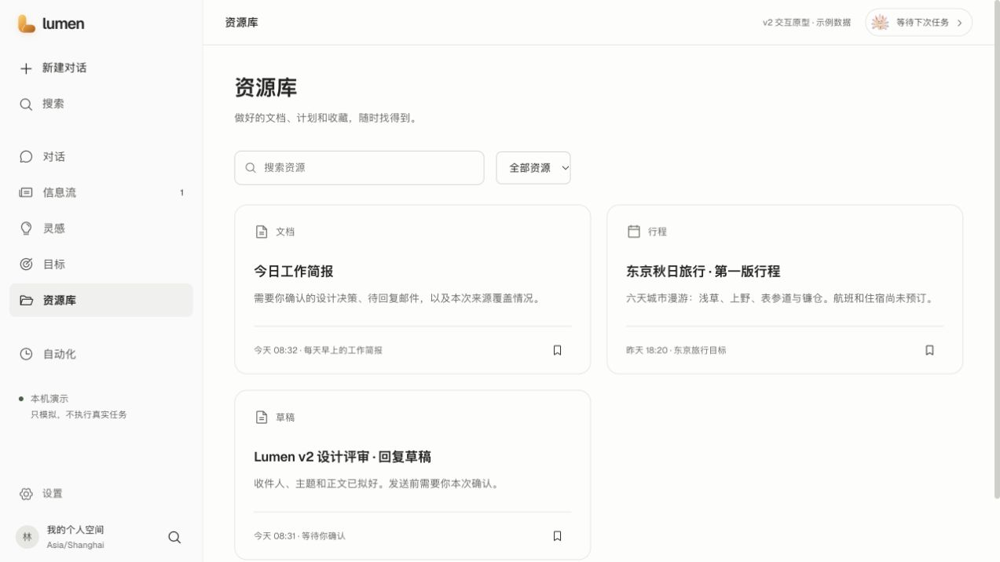

# Lumen v2 原型优化：Muse 的信息组织，Lumen 的界面与形象

2026-10-20 · r2。依据用户第二轮明确反馈更新；这是设计提案，尚未实现自动化后端。

后续核验（2026-10-21）：本文保留研究当日状态。新的[官方资料核验及当前产品审计](../../docs/research/2026-10-21-muse-chatgpt-space-product-research.md)更正设计原文入口为 Meta 官方链接的 `https://introducing.muse.ai/`；下文旧域名及固定菜单推导不再作为当前权威。目标／对话／资料的优化以[新实施计划](../../docs/plans/2026-10-21-lumen-v2-product-flow-upgrade.md)为后续施工输入，尚未实施。

## 1. 本轮决定

保留当前 Lumen 的界面身份：原 Logo、Geist 字体、白灰背景、墨色正文、细边框、黑色主按钮和动态九尾狐。借鉴 Muse 的对话、信息流、灵感、目标、资源库结构，取消独立“记忆”导航，把个性化偏好和连接管理收进设置。

主要工程参考保持为 [Claude：Building effective agent automations](https://claude.dev/blog/building-effective-agent-automations/)。不再把“补齐第二篇文章”当作待决事项；Palantir / Temporal / DSH 等仅是原 design/ 蓝图的历史背景，不是本轮产品方向的依据。

第一轮新生成的 Q 版形象、暖纸白与朱橙主题已退出当前原型。旧素材和编号截图保留作为历史，不再作为当前界面的视觉权威。

## 2. 参考资料与证据

| 来源 | 用途与边界 |
| --- | --- |
| [已批准的 r2 原型](README.md) | 当前生产构图依据；旧独立 Muse 原型已清理，不再保留无效入口 |
| [Muse 设计文章](https://introducing-muse.com/) | 持续目标、适度主动性、活动透明度与确定性审批的产品参考；已在前一轮读取 |
| [Claude 自动化文章](https://claude.dev/blog/building-effective-agent-automations/) | 主要技术参考；结果真实性、持久状态、可靠投递与明确边界，不要求替换 Lumen 运行时 |
| `src/web/src/app/globals.css` | 当前 Lumen 的真实 token 与组件样式。优先于第一轮提案的 DESIGN.md |
| `landing-entry.tsx`、`landing-entry.module.css` | 当前欢迎页的结构、输入框、形象尺寸与位置 |
| `mascot/video-mascot-renderer.tsx`、motion / visibility hooks、原 idle/react 视频 | 复用真实动态形象；保留 authored movement、减少动效、离屏暂停与静态降级 |
| Host / Coordinator / Loop / Gateway / Memory / Work Product 源码 | 证明已有能力；design/ 蓝图不能证明新功能已实现 |

## 3. 为什么更接近 Muse，但保留 Lumen

Muse 的信息架构有助于把“说过的话”“已经发生的变化”“可以做的下一步”“长期想实现的结果”和“做好的产物”分开。它的设计文章强调后台工作的可检查性，以及值得打扰用户才主动联系。[原文](https://introducing-muse.com/)

本轮把这个区分转化为五个主要入口：

| 入口 | 用户问题 | 关键交互 |
| --- | --- | --- |
| 对话 | 现在有什么可以交给你？ | 自然表达、继续讨论、将原始意图带入自动化草稿 |
| 信息流 | 我关注的事，有什么新变化？ | 已执行结果、目标进展、来源提示、待确认动作、收藏、继续聊 |
| 灵感 | 接下来可以尝试什么？ | 推荐理由、工作/生活/学习分类、开始、不感兴趣、恢复隐藏建议 |
| 目标 | 我想达到什么结果，下一步是什么？ | 明确里程碑、关联自动化与资源，不展示无定义的智能完成率 |
| 资源库 | 生成或收藏的东西在哪里？ | 文档、行程、草稿、笔记的搜索、类型筛选、打开、编辑与收藏 |

自动化保留在第二层管理位置，用于查看执行规则、时间、时区、来源和预算，以及试运行、启用、暂停。搜索为全局动作，不挤成另一个内容页。设置管理个性化偏好与连接权限，不再把“记忆”当独立产品入口。

默认仍进入与当前 Lumen 类似的对话欢迎页。信息流不是每天必须浏览的仪表盘；用户可以继续用对话完成即时任务。

## 4. 三个必须区分的概念

**信息流是已经发生或已准备好的更新。** 每条内容关联真实来源覆盖、任务、产物或待审批动作。卡片展示简要结果，详情打开已有资源。不能把来源失败包装成“没有变化”，也不能把准备好的草稿写成“已发送”。

**灵感是尚未执行的建议。** 建议说明为什么出现；不感兴趣只影响建议显示。点击开始先进入对话，确认意图后才创建目标或自动化草稿。它不会直接启用后台任务，也不会扩大工具权限。

**资源库是稳定的产物与收藏引用。** 一个结果可以在聊天和信息流出现，但资源库保存相同资源的引用，不复制一份不受版本管理的正文。收藏一份笔记后可以在资源库找到，取消收藏后移除该收藏引用。

这三个入口需要共享对象引用，不能各自通过解析聊天文字推断事实。

## 5. 界面样式：继承当前产品

| 角色 | 当前 Lumen 来源 | r2 采用值 |
| --- | --- | --- |
| 页面背景 | `globals.css :root --page` | `#FDFDFC` |
| 侧栏实际背景 | `.session-sidebar` | `#FAFAFA` |
| 正文 | `--ink` | `#242422` |
| 次级正文 | `--ink-soft` | `#555552` |
| 辅助文字 | `--muted` | `#6B6B67` |
| 分隔与边框 | `--line` / `--line-strong` | `#E5E5E2` / `#D5D5D1` |
| 主操作 | 当前 Composer / 按钮 | 墨色底、白色字 |
| 品牌标记 | `src/web/public/lumen-mark.svg` | 原 Lumen Fold，不以狐狸替换 Logo |
| 欢迎页形象 | 现有 `LandingEntry` | 桌面 168 px；窄屏调整为 130 px |

信息流、灵感和资源库沿用中性表面、清晰排版和轻边框。原 Logo 的琥珀色保留，状态警告可以有克制的语义色；不把它们扩展为新主题。深色是额外预览，默认仍为当前 Lumen 浅色。

## 6. 动态形象的实际复用

`mascot-entry.tsx` 只提供静态原型的 React 挂载桥接。它引用原 `VideoMascotRenderer`、`useMascotMotionPreference`、`useMascotVisibility`，没有重写视频 shader 或播放状态机。

`build-mascot.cjs` 使用仓库已安装的 esbuild，复制原 idle / react clips 与 poster，将原渲染器的绝对资源路径适配为原型目录路径，生成 `assets/mascot-player.js` 与 CSS。用户打招呼与输入聚焦通过原播放能力反馈；页面离屏或隐藏时暂停；系统减少动效时用原 poster。

浏览器已观察到 `data-renderer="video"`、可见 canvas 和有效绘制尺寸；截图只记录其中一帧，不把它当作新生成的静态形象。

原型换页时先 unmount，触发播放器清理视频、回调、观察器和 WebGL 资源，再挂载新页面。只在对话欢迎页实例化动态播放器，顶部活动按钮使用原 poster 缩略图，避免每张卡片都启动解码器。

## 7. Claude 自动化原则如何落到新 UI

文章给本轮的主要检查项是：来源读取要连续、失败要可见、信息在发布前复核、送达后再记账、用户偏好与运行状态分开、权限和费用有边界。[主要参考](https://claude.dev/blog/building-effective-agent-automations/)

以下是结合 Lumen 源码的实施推论：

| 工程契约 | 新界面中的位置 |
| --- | --- |
| SourceCheckpoint 与 source coverage | 信息流说明已读与未读来源，资源详情保留生成时覆盖，不随连接恢复追改历史 |
| 结果生成与 delivery receipt 分离 | “查看草稿并确认”与“已送达”分开；unknown 进入执行详情回查 |
| 每次运行读取用户确认偏好 | 设置中的个性化偏好；候选需要确认，不是工具执行授权 |
| 默认只提醒有意义变化 | 信息流筛选与通知偏好；无变化保持安静，失败和待用户动作仍可见 |
| 显式来源、时间、预算与停止条件 | 自动化草稿表单，试运行后启用；灵感不会跳过此流程 |
| 同一 occurrence 的稳定引用 | 对话、信息流、目标、资源库打开同一结果，不各建状态权威 |

仍不把无人值守当成自动许可。根 Host 的 Git commit / push 每次新审批、Gateway 风险策略、Effect 验证与恢复边界继续生效。

## 8. 现有实现与缺口

| 已有能力 | 代码入口 | v2 用法 |
| --- | --- | --- |
| 多端统一命令、run admission | `application/host.py`、`models.py`、`run_lock.py` | 新页面仍使用 Host Interface |
| 单 turn 执行和恢复 | `run_coordinator.py`、`runtime.py`、`agent_loop/loop.py` | 复用；补跨会话 occurrence 的耐久关联 |
| 工具风险、Effect、并发 | `tools/spec.py`、`tools/gateway.py` | 保留三轴独立；不增加后台特权 |
| Canonical history / 大载荷 | `sessions.py`、`context/artifacts.py` | v12 append-only journal 继续拥有对话；正文按引用打开 |
| Work Product 与验证 | `work_products/workspace.py`、`completion.py` | 资源库引用已有可验证产物 |
| 偏好与学习 | `context/memory/*` | 复用范围、来源、遗忘、冲突；不再新建通用记忆系统 |
| MCP / OAuth | `mcp_tools.py`、`mcp_resources.py`、`mcp_oauth.py` | 复用现有装配和凭据 Seam，再补具体来源健康与撤销语义 |
| 动态形象 | `components/mascot/*`、原 MP4 | 直接复用，降低设计与制作成本 |

新增缺口仍是：自动化定义、持久触发、跨存储恢复、可靠投递、信息流投影、建议生命周期、跨 Session 资源与收藏索引。当前 Host 只允许同工作区一个主 run，现有 StartRun 请求去重在进程内；本轮原型没有改变这些事实。

不因增加信息流和灵感而引入第二套 Runtime。首发仍是本地 Host 上可靠的只读任务闭环；远程常驻、更多 OAuth 来源与真实外发各自经过验收。

## 9. 原型体验与证据

1. **对话入口：已检查。** 当前 Lumen 风格的输入框、原 Logo、真实动态播放器；快捷建议填入输入框，不自动发送。
2. **信息流：已检查。** 筛选、主题设置、收藏、打开资源、继续讨论；待确认项不因主题选择被悄悄隐藏。
3. **灵感：已检查。** 分类、不感兴趣、恢复、开始；进入对话后保留建议意图，不直接启用自动化。
4. **资源库：已检查。** 搜索、类型与收藏筛选、阅读与简报编辑；信息流收藏与资源库同步。
5. **持续任务与设置：已有回归覆盖。** 试运行、暂停、来源异常、预算、送达核对，以及设置内的偏好与连接。

移动端证据见 [对话](evidence/r2-chat-mobile.jpg) 与 [信息流](evidence/r2-feed-mobile.jpg)。旧编号 01—05 仍是前轮捕获的参考原型/当前产品结构证据；06—14 是已经被本轮取代的视觉提案。

## 10. 限制

对话、信息流、灵感、授权和运行状态仍为本机示例；没有读取真实账号，没有创建实际定时任务，没有发送真实消息。复用真实动态播放器不等于自动化后端已经完成。

没有更改 `src/web/` 或 Python 运行时代码；第一轮生成形象保留为历史资产、不再被当前 UI 引用。本轮未宣称真实设备、屏幕阅读器或生产恢复验收。实际验证与限制见 [validation.md](validation.md)，技术落点见 [implementation-plan.md](implementation-plan.md)。
