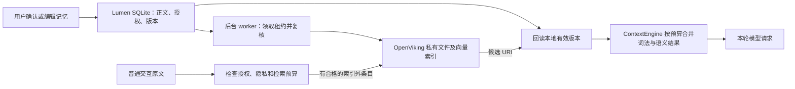

# Lumen + OpenViking 长期记忆手册

适用于本仓库的 Lumen 和 **OpenViking v0.5.6**。Lumen 默认在本机保存和检索记忆。需要用另一种说法找回过去确认的事实时，可以为当前项目或个人记忆单独授权 OpenViking。使用已有服务的读者可从第 3 节的身份核验开始，自托管从第 2 节开始。

按任务阅读：[部署服务](#deploy) · [接入已有服务](#connect) · [第一次写入和跨会话使用](#use) · [数据存储与恢复](#storage) · [排障与撤回](#operate)。

## 1. 两套系统各负责什么

| 层 | 职责 | 本次接入如何使用 |
| --- | --- | --- |
| Lumen | 决定哪些记忆有效、属于谁、何时能给模型看 | SQLite 保存正文、来源、有效期、授权与同步账本；本地全文检索和固定索引可独立工作 |
| OpenViking 上下文文件系统 | 用 `viking://` URI 组织用户、Agent 和资源，以目录表达上下文关系，通过身份和 ACL 控制访问 | 每个获准版本对应用户私有资源树中的一个文件。Lumen 保留 URI 与本地版本的映射 |
| OpenViking 检索与处理 | 文件系统层保存内容，向量索引支持语义检索。上下文按 L0 摘要、L1 概览和 L2 详情分层，部署所选的 embedding 和生成模型负责向量化、语义处理 | Lumen 写文件时指定 `vectors_only`，查询只取指定根目录下的 L2 候选 URI。Lumen 交给对话模型的正文来自本地 SQLite |
| 上游会话与长期记忆提取 | OpenViking 也提供自己的会话、归档和记忆提取能力 | Lumen 自己的学习器、确认操作和 Session journal 持有会话语义。本接入使用资源写入、检索和清理 API；会话消息、工具输出和附件不作为索引语料发送 |



典型场景是先记住“发布变更先给内部账号”，再在同一项目的新会话里问“第一批受众是谁”。少量记忆若已完整放入固定索引，Lumen 会直接使用它们，用户不必为了跨会话记忆而部署服务。[OpenViking 项目与概念](https://github.com/volcengine/OpenViking/tree/v0.5.6/docs/en/concepts) · [v0.5.6 私有资源与 ACL](https://github.com/volcengine/OpenViking/blob/v0.5.6/docs/en/concepts/15-acl.md)

<a id="deploy"></a>

## 2. 自托管一个持久化服务

以下单机示例使用 Docker Compose、Python 3、curl 和 jq，需要可用磁盘及模型下载网络。两个容器在同一 Compose 网络中通信，只有 OpenViking 的 HTTP 端口发布到宿主机回环地址。模型使用试点的 1024 维 `qwen3-embedding:0.6b` 和文本生成模型 `qwen2.5:0.5b`；这个选型便于重现实验，回答质量见第 8 节。

在仓库以外新建一个私有目录，**后续部署和管理命令均在同一目录执行**。以下代码块按 Bash 编写。保留这个目录、Compose 项目名和卷；更换目录或项目名可能让 Compose 创建新的空卷。

```bash
umask 077
mkdir -m 700 lumen-ov-deployment
cd lumen-ov-deployment
```

保存为 `compose.yaml`。可按需要设置宿主机变量 `OV_PORT`，下例默认 1933。OpenViking 容器内使用 `/data` 作为持久工作区，模型文件保存在独立卷里。

```yaml
services:
  models:
    image: ollama/ollama@sha256:1cabd20e1762a7a8444bf4a7110b346d923cd77ab6c97c984434140638c913ec
    restart: unless-stopped
    volumes:
      - model-data:/root/.ollama
  openviking:
    image: ghcr.io/volcengine/openviking:v0.5.6
    restart: unless-stopped
    environment:
      OPENVIKING_WITH_BOT: "0"
    ports:
      - "127.0.0.1:${OV_PORT:-1933}:1933"
    volumes:
      - ./ov.conf:/app/.openviking/ov.conf:ro
      - viking-data:/data
volumes:
  model-data: {}
  viking-data: {}
```

生成 `ov.conf`。脚本创建随机 root 管理密钥，使用独占创建以避免重跑时覆盖已有配置。保管此文件，root 密钥只供服务管理员使用。示例中的模型地址是容器网络名 `models`。

```bash
python3 - <<'PY'
import json, os, secrets
from pathlib import Path

os.umask(0o077)
config = {
    "server": {"host": "0.0.0.0", "port": 1933, "auth_mode": "api_key",
               "root_api_key": secrets.token_urlsafe(48)},
    "storage": {"workspace": "/data", "agfs": {"backend": "local"},
                "vectordb": {"backend": "local"}},
    "embedding": {"dense": {"provider": "ollama", "model": "qwen3-embedding:0.6b",
                            "api_base": "http://models:11434/v1", "dimension": 1024}},
    "vlm": {"provider": "openai", "model": "qwen2.5:0.5b",
            "api_base": "http://models:11434/v1", "api_key": "ollama",
            "temperature": 0, "max_tokens": 96},
}
with Path("ov.conf").open("x") as file:
    json.dump(config, file, indent=2)
PY
docker compose config --quiet
docker compose up -d models
docker compose exec -T models ollama pull qwen3-embedding:0.6b
docker compose exec -T models ollama pull qwen2.5:0.5b
docker compose up -d --wait openviking
docker compose ps
```

等待服务就绪后再创建账号。Docker Desktop 可为单机试点分配 CPU 和内存；生产容量应按自己的语料、并发和模型测量。跨机器访问时，在受控入口配置 TLS 和有效证书，把 Lumen 的 endpoint 指向 HTTPS 源站，并限制管理 API 的访问。已有团队服务须满足第 3 节的身份契约。替换模型时确认容器能访问模型地址，向量维度与实际模型输出一致。更换 embedding 模型、维度或存储后，在独立工作区重建并核验召回再切换。[上游固定版部署指南](https://github.com/volcengine/OpenViking/blob/v0.5.6/docs/en/guides/03-deployment.md) · [上游配置字段](https://github.com/volcengine/OpenViking/blob/v0.5.6/examples/ov.conf.example)

<a id="connect"></a>

## 3. 准备服务身份并连接 Lumen

**已有服务。** 向管理员领取专属 HTTPS 源站地址和一个租户用户 key，直接执行本节的健康检查与 Lumen 配置。客户端要求 `/health` 报告健康、版本 `v0.5.6` 或 `0.5.6`、`auth_mode=api_key`、非空 account/user 及 user 或 admin 角色。推荐普通 user。开发模式、root 身份、OIDC、LDAP、路径前缀 URL 和跳转入口无法通过这套客户端契约。若上游挂在共享域名的路径下，须提供从根路径转发 `/health` 和 `/api/v1/…` 的专用源站。

**新服务。** 下面的一次性初始化为示例租户 `lumen-team` 建立管理员和普通用户。输出凭据分别保存到当前私有目录。不同的 Lumen 用户应分别领取自己的用户 key，多个项目可复用同一用户身份。中途失败时先向管理员核对已建账号和用户，再继续剩余步骤。[上游账号与身份管理](https://github.com/volcengine/OpenViking/blob/v0.5.6/docs/en/guides/04-authentication.md)

```bash
python3 - <<'PY'
import http.client, json, os
from pathlib import Path

os.umask(0o077)
root = json.loads(Path("ov.conf").read_text())["server"]["root_api_key"]
account = "lumen-team"
def provision(path, payload, key_file):
    if Path(key_file).exists():
        raise SystemExit(f"{key_file} 已存在，请先核对账号状态")
    client = http.client.HTTPConnection("127.0.0.1", int(os.getenv("OV_PORT", "1933")), timeout=15)
    try:
        client.request("POST", path, json.dumps(payload),
                       {"X-API-Key": root, "Content-Type": "application/json"})
        response = client.getresponse()
        if response.status not in (200, 201):
            raise SystemExit(f"创建失败，HTTP {response.status}")
        key = json.load(response)["result"]["user_key"]
        with Path(key_file).open("x") as file:
            file.write(key + "\n")
    finally:
        client.close()

provision("/api/v1/admin/accounts", {"account_id": account, "admin_user_id": "operator"}, "admin.key")
provision(f"/api/v1/admin/accounts/{account}/users", {"user_id": "assistant-user", "role": "user"}, "lumen-user.key")
PY
```

用普通用户 key 检查身份，以下示例只输出健康状态和角色。使用现有服务时，将 `OV_URL` 替换为相应源站，并通过自己的密钥管理工具设置 `LUMEN_OPENVIKING_API_KEY`。不要把 key 粘贴进聊天、版本库或命令历史。

```bash
export OV_URL="http://127.0.0.1:${OV_PORT:-1933}"
export LUMEN_OPENVIKING_API_KEY="$(cat lumen-user.key)"
printf 'X-API-Key: %s\n' "$LUMEN_OPENVIKING_API_KEY" |
  curl --fail --silent --show-error --header @- "$OV_URL/health" |
  jq -e 'select(.status == "ok" and .healthy == true and
                (.version == "v0.5.6" or .version == "0.5.6") and .auth_mode == "api_key" and
                (.account_id | type == "string" and length > 0) and
                (.user_id | type == "string" and length > 0) and
                (.role | ascii_downcase | sub("^role\\."; "") | . == "user" or . == "admin"))
         | {healthy, version, auth_mode, role}'
```

在 **Lumen 用户配置** `~/.lumen/agent.yaml` 或通过 `--config` 明确指定的配置中，合并以下片段。在同一环境启动或重启 Lumen Host，桌面启动的 Host 也必须能读取指定变量。YAML 只填写变量名。项目、项目本地及 Web 受管配置声明 `memory.openviking` 会被拒绝。连接只接受 HTTPS 或回环 HTTP，endpoint 不含凭据、查询串或路径前缀。

```yaml
memory:
  use: true
  learn: false
  openviking:
    enabled: true
    endpoint: http://127.0.0.1:1933
    api_key_env: LUMEN_OPENVIKING_API_KEY
```

按实际端口修改 endpoint。运行 `lumen --check-config` 验证配置语法；显式配置使用 `lumen --config /path/to/agent.yaml --check-config`。**连接配置与数据授权分两步**。检查配置或读取同步状态不会授予外发权限；首次执行所选范围的 `enable` 才会核验远端身份并建立授权。

| 用户配置字段 | 默认值 | 配置规则 |
| --- | --- | --- |
| `memory.openviking.enabled` | `false` | 设为 `true` 才装配连接，同时必须指定 endpoint |
| `memory.openviking.endpoint` | 无 | 源站 URL，可含端口，禁止内嵌用户名、密码和片段 |
| `memory.openviking.api_key_env` | `LUMEN_OPENVIKING_API_KEY` | 通过启动 Host 的环境注入用户 key；可指定其他有效的环境变量名 |

<a id="use"></a>

## 4. 用一条合成记忆验证接入

1. 打开根会话，执行 `/memory openviking status project`，核对服务地址、授权状态和可同步条目数。Web 也可进入「个性化偏好 → OpenViking 语义记忆」，选择「当前项目」并读取状态。
2. 执行 `/memory openviking enable project`。授权后，服务及其模型可能处理合格记忆正文和普通交互中的检索文本。若只做冒烟测试，请在隔离的 Lumen 用户目录和测试项目操作。
3. 执行 `/memory remember 发布变更先给内部账号`，保存返回的记录 ID。再次读取同步状态，等待首次成功、待同步归零。文件写入成功后，远端索引可能仍在处理。
4. 在同一项目的新会话用普通输入框问“第一批受众是谁？”少量记录可直接由固定索引提供。单次回答不能证明命中了远端，对比检索效果可用第 8 节的评测。
5. 执行 `/memory forget <记录ID>`，核对本地列表及远端清理状态。只想移除这条测试记忆时到此为止。专用试点若要清空整个项目的在线副本，可执行 `/memory openviking purge project`，保留原服务和凭据直至待清理归零。

| 意图 | TUI 或 Web 操作 | 作用范围 |
| --- | --- | --- |
| 查看本地状态与记忆 | `/memory status`、`/memory list` | 当前 Host 可见的本地记录；远端同步另用 `openviking status` |
| 记住、修改、确认 | TUI 用 `/memory remember <正文> --scope user`，或 `/memory edit <id> --set <新正文>`。TUI 也可先 `edit <id>` 导出草稿，再 `edit <id> --apply`。Web 用「个性化偏好」选择范围、编辑、确认候选 | 默认为项目范围；`user` 记忆可跨项目。本地写入仍需满足远端授权才能同步 |
| 遗忘 | `/memory forget <id>` | 推荐 ID。文本参数按子串匹配，可能同时命中多条记忆 |
| 启用或停用 | `/memory openviking enable project`、`disable project`（后者同样带 `/memory openviking` 前缀） | 只改变选中范围。停用保留已写入的在线副本；个人范围将 `project` 换成 `user` |
| 回填旧记录 | `/memory openviking backfill project` | 已授权范围中现有合格条目入队，并重新核验已知版本。启用时默认从后续合格写入开始 |
| 撤权并清理 | `/memory openviking purge project` | 整个选中范围中、账本已登记的在线版本。Web 设置页有二次确认；直接输入命令即请求清理 |
| 重建本地 Markdown | `/memory rebuild` | 使用 SQLite 重新生成审阅文件。修复远端投影可用 `backfill` |

OpenViking 操作省略范围时使用 `project`。TUI 的 `--scope`、`--set` 和 `--apply` 是该客户端的解析语法；Web 输入框设置个人范围、修改正文时请使用表单。运行期间 Host 可处理 OpenViking 专项控制；普通 `/memory` 管理和隐私切换需等当前 run 结束。

停用或清理 OpenViking 后，仍有效的本地记忆仍可进入对话。要关闭后续普通交互的记忆召回，先结束正在运行的轮次，再执行 `/memory use off`；要撤回某条事实，执行 `/memory forget <id>`。即使只使用本地检索，选入上下文的正文仍会随主模型请求发送给 Lumen 当前配置的对话模型。

自建客户端可复用已经鉴权的 Lumen Web 会话，向 `POST /api/v1/sessions/{session_id}/controls` 发送下列 JSON。返回的 `message` 适合交互展示，`payload` 用于读取结构化状态。这里使用 Lumen 自身的访问凭据；OpenViking 的用户 key 只由 Host 持有。[Lumen API 契约](../src/web/openapi.json)

```json
{"type": "memory", "action": "openviking", "payload": {"operation": "status", "scope": "project"}}
```

## 5. 哪些数据会写入和召回

| 条件 | 同步记忆 | 处理本轮查询 |
| --- | --- | --- |
| 项目与身份 | 项目授权匹配当前 canonical project ID；同一 Git 仓库的 worktree 共用项目身份。个人记忆需另授 `user` | 只查已授权并有就绪条目的私有根。服务或账号变更后按新的绑定判断 |
| 来源与状态 | 当前有效、`active`、`explicit` 的 USER 或 PROJECT 记录；用户确认推断记录后可转为 explicit | 普通 TUI/Web 输入框显式标记的本轮用户原文；生成的任务、headless、Live、child、重生成和后台自动化不获得此查询来源 |
| 敏感内容 | 排除 `restricted`、PATH、AGENT、已过期、遗忘、冲突、未确认记录，以及命中敏感模式的内容 | 先检查整段原文；发现已识别的密钥、邮箱、部分证件号码等即跳过；通过后最多发送 512 个字符。附件字节、展开的文件、历史和工具结果不拼入查询 |
| 开关 | 已授权后，`memory.learn=false` 仍允许同步手工记住的内容。`memory.use=false` 关闭召回，后台同步仍可继续 | 默认 `use=true`、`learn=false`。隐私模式阻止当前 Host 的召回、上传和清理派发，丢弃在途查询的结果 |

**隐私模式的边界。** `/memory incognito on` 是当前 Host 的记忆开关。隐私期间仍可手工保存和编辑本地记忆；这些写入会被标记并从普通回填排除。会话 journal 仍保存对话；离开隐私模式后，同一会话若触发学习，提取器可能读取早先轮次。需要隔开私密对话时，结束该会话，用新会话继续开启学习的工作。重启 Host 会重新读取配置；持久化的项目／个人授权另由 SQLite 管理。匹配规则只能识别已知模式，输入者仍需判断服务和模型是否适合处理具体资料。[记忆管理](../src/lumen/context/memory/manager.py) · [提取来源](../src/lumen/resources.py) · [敏感规则](../src/lumen/context/memory/redaction.py)

**一次模型请求怎样得到记忆。** ContextEngine 先按行、字节和 token 预算装入完整的固定索引条目。只有实际装入的 ID 才从动态召回中排除。所有可用投影都已覆盖时跳过网络；需要语义查询时，每个符合条件的 turn 最多发一次 `find`，最多接收 8 个候选，等待预算 300 ms，超时后继续本地词法召回。网络等待预算不等于首 token 总延迟。

收到 URI 后，Lumen 只接受本地账本登记、授权仍有效且属于期望版本的条目。按名次交替合并词法与语义结果，同名次词法在先，再按动态区预算选完整记录；上游返回的摘要或指令不会成为模型正文。重试和后续步骤复用本轮候选，在实际模型请求边界重查版本、遗忘和权限。临时召回块不会追加到 canonical history，动态使用次数按实际派发的轮次计数。[上下文装配](../src/lumen/context/engine.py) · [请求边界回归](../tests/test_viking_recall.py)

<a id="storage"></a>

## 6. 存储布局、HTTP 契约和故障恢复

| 位置 | 内容 | 运维意义 |
| --- | --- | --- |
| `~/.lumen/state/memory.sqlite3` | 本地正文与生命周期、派生 FTS5 全文索引、授权、回填清单和版本任务 | 记忆和授权的本机权威。记录变更与待同步意图提交于同一事务；离线仍可工作 |
| 同目录 `memory.sqlite3.openviking-guard` | 独立保存的恢复校验标记 | 保留最新副本以检测旧主库恢复。主库与标记一起回滚到同一旧时点时无法发现后来发生的撤权 |
| 同目录 `memory-work.sqlite3` | 本地后台学习任务 | 与 OpenViking 同步队列分开备份和排障 |
| `~/.lumen/projects/<project_id>/memory/` | 可审阅的 `MEMORY.md`、`topics/` 和编辑草稿 | 可从本地记录重建。管理操作经 Host 写回 SQLite |
| OpenViking `viking-data` 卷中的 `/data` | 用户及账号元数据、文件系统内容、向量索引和服务任务状态 | 在容器重建时保留；备份须覆盖服务工作区。向量库也可能保存检索文本和元数据，需按正文同等级保护 |
| `model-data` 卷、私有部署目录 | Ollama 模型缓存；`ov.conf`、管理员 key 和用户 key | 模型可重新下载；配置与凭据需限制读取并单独保管 |

**远端命名。** 项目文件的逻辑 URI 是 `viking://user/<user>/resources/lumen/<binding>/projects/<项目哈希>/<记录ID哈希>/<版本>.md`。个人文件把 `projects/<项目哈希>` 换成 `user`。binding 区分服务源站、账号和用户，版本由本地行号及随机标识组成。每个版本单独写合格正文；不会把项目绝对路径、完整 journal 或来源事件列表写入这个资源。不要根据 URI 猜服务的物理磁盘路径。[投影账本与命名](../src/lumen/context/memory/viking_store.py)

**OpenViking 自身的设计。** VikingFS 把资源、记忆与技能映射到目录树；文件操作落到 AGFS（Rust 实现称 RAGFS），向量后端按 URI 保存检索所需的向量、元数据和文本。常规资源处理可异步从文件生成目录级 L0 摘要和 L1 概览，L2 对应详细内容。检索在获准范围内使用向量召回，并可选重排。由此产生两个运维要求：磁盘已有文件与语义检索就绪是不同状态；一致恢复需同时考虑内容与索引。本例的 `vectors_only` 写入不依赖目录摘要作为答复依据。[上游架构与数据流](https://github.com/volcengine/OpenViking/blob/v0.5.6/docs/en/concepts/01-architecture.md) · [存储](https://github.com/volcengine/OpenViking/blob/v0.5.6/docs/en/concepts/05-storage.md) · [检索](https://github.com/volcengine/OpenViking/blob/v0.5.6/docs/en/concepts/07-retrieval.md)

| Lumen 对 v0.5.6 的请求 | 契约 |
| --- | --- |
| `GET /health` | 以该用户的 `X-API-Key` 核验版本、模式、身份和健康。重启时符合持久授权及凭据指纹的变更可先入队，再经远端身份核验派发 |
| `POST /api/v1/content/write` | 固定版本 URI，`mode=replace`、`processing_mode=vectors_only`、`wait=false`。只发送正文，核对回执 URI |
| `POST /api/v1/search/find` | 非空 `target_uri` 根列表，`level=2`、`limit=8`、`read_content=false`。目录、未知或陈旧 URI 不会通过本地映射 |
| `DELETE /api/v1/fs`、`GET /api/v1/fs/stat` | 精确 URI、`recursive=false`、`wait=false`。删除后检查对象已不存在，也用 stat 核验结果未知的写入及丢失的就绪对象 |

单个 HTTP 操作另有 8 秒上限，客户端拒绝重定向，限制响应体、只保留受控错误分类。授权、租约与确认均在本地按绑定和版本核验。每个版本经历 `write → ready`；编辑、遗忘、自然到期等可使旧版本进入 `delete → clean`。断电后 60 秒租约到期可重新领取；过时回执不能重新激活旧版本。清理成功后仍保留账本，以便核验迟到写；就绪或已清理对象有周期复查，同一绑定限速派发。远端缺失且本地仍有效的版本可重排写入。[HTTP Adapter 与 worker](../src/lumen/context/memory/openviking.py) · [存储回归](../tests/test_viking_store.py)

本地投影表按用途分为三组。身份与授权使用 `ov_binding`、`ov_writer_key` 和 `ov_grant`，其中保存的是凭据指纹。版本与调度使用 `ov_object`（版本 URI、期望状态、租约、重试和成功时间）及 `ov_backfill`。恢复与观测使用 `ov_checkpoint`、`ov_private`、`ov_audit` 和 `ov_health`。worker 每次派发前从本地记录取正文，状态面板只读取操作元数据。

<a id="operate"></a>

## 7. 日常运维、备份和退出

先用 `/memory openviking status project` 或 `status user` 检查对应范围。状态会列出目的地、是否授权、符合条件的记录、待同步及待清理数、最近成功、最长等待和错误。结构化状态还含 `ready`、`backfill`、`consecutive_errors` 等字段，`pending` 包含回填待办，`fallbacks` 是当前 Host 的查询回退计数。在 Web 设置页点击「读取同步状态」可重新读取。

| 观察到的情况 | 解释与处理 |
| --- | --- |
| 未配置、可同步数为零 | 核对配置来源、Host 的环境和启动时间。分别看 `project`、`user` 授权，确认记录有效、已确认且不属于隐私写入 |
| 写入就绪但查不到 | 索引可能仍在处理，也可能目标已完整进入固定索引。检查模型服务、向量维度、队列、有效版本；需要重新校验已知对象时执行该范围的 `backfill` |
| `query_timeout` 或回退数增加 | 本轮使用本地记忆。排查模型冷启动、队列积压、网络与并发；运行 `docker compose ps`、`docker compose exec -T models ollama list` 查看服务和已安装模型 |
| `authorization_failed`、`unsupported_service_identity`、`identity_changed` | 用第 3 节核验普通用户 key、角色、账号、版本和源站。更新保密环境后重启 Host，按预期身份重新授权。权限错误不能当作已删除 |
| `transport_error`、`http_429` 或 `http_5xx` | 检查 TLS、地址、服务及模型可用性。后台任务按退避时间重试；无需为了清队列反复写同一条记忆 |
| `storage_unavailable`、清理长期积压 | 检查本地磁盘空间、文件权限和 SQLite 可用性；确认原绑定身份仍能访问服务、未处于隐私模式。优先保留账本及恢复校验文件 |

- **例行重启。** 在部署目录运行 `docker compose stop`，再 `docker compose up -d`。保留两个命名卷和 `ov.conf`；避免使用会删除命名卷的 `down -v`。多人部署要分别确认 Host 能取得各自凭据。
- **备份与恢复。** 在一致时点备份本地 SQLite（或停所有写它的 Host 后复制），另保留最新 guard 和授权变更记录。服务侧备份静止或一致快照下的持久卷和配置，凭据备份采用受限存储。恢复旧主库遇到标记不匹配时会暂停授权并标记已知版本待清理。先核对撤权记录和身份，再选择清理或重新授权、回填。若仅向量索引损坏但文件还在，需用对应版本的 OpenViking 运维流程重建索引，再实查命中；文件存在性验证无法证明向量索引完整。
- **轮换与迁移。** 同账号更新用户 key 后重启 Host、复核身份。更换端点或账号前，若需要删除旧在线副本，先在原配置执行 `purge` 并确认清理成功；再配置新服务、分别授权、显式回填。凭据已失效时，应先恢复原身份的访问或请原服务管理员协助清理。
- **退出与删除。** 要继续纯本地使用，分别 `disable` 曾启用的项目和个人范围。要移除在线数据，先 `purge` 相关范围，核对待清理归零和成功时间，再移除连接。Lumen 只清理本地账本登记的 URI；账本丢失后，未登记的孤儿资源需由服务管理员核查。服务备份的删除和保留期由运营方处理。

## 8. 发布判断、验收与源码入口

真实 v0.5.6 试点以 112 个合成问题进行三组对照。长索引中，中文改写动态 Recall@5 从本地的 0/25 提升到 22/25，英文从 0/25 提升到 21/25。但 25 个无答案问题里有 22 个注入了无关记忆；抽样答题从 5/20 到 6/20，首 token p95 从 792 ms 升到 1,998 ms。因此 Lumen 默认保留本地方案，OpenViking 供显式授权试点。这里的延迟属于该次模型、机器和并发条件。[试点报告及复测命令](research/2026-11-26-openviking-pilot.md) · [逐题结果](research/2026-11-26-openviking-pilot-results.json)

在本次手册核验中，使用隔离的 Linux 容器和本地 Ollama，按第 2、3 节生成配置、下载两个模型、创建租户并通过健康检查；随后由真实 WorkspaceHost 写入合成记忆，等模型索引完成，用中文改写命中该 URI，验证遗忘后本地拒绝该版本且在线对象已删除。重建 OpenViking 容器并保留持久卷后，原用户 key 仍通过同一身份核验。网络或模型服务不可用时，可先跑项目的离线回归。

```bash
uv run --extra web --extra live pytest tests/test_openviking_client.py tests/test_viking_store.py tests/test_viking_recall.py
```

维护实现时，可沿根 Host、资源装配、记忆管理、SQLite 权威和上下文引擎追踪请求。后端选型的原始依据单独保留。[根 Host](../src/lumen/application/host.py) · [资源装配](../src/lumen/resources.py) · [记忆管理](../src/lumen/context/memory/manager.py) · [SQLite](../src/lumen/context/memory/repository.py) · [上下文引擎](../src/lumen/context/engine.py) · [后端选型](research/2026-11-25-external-memory-backends.md)
