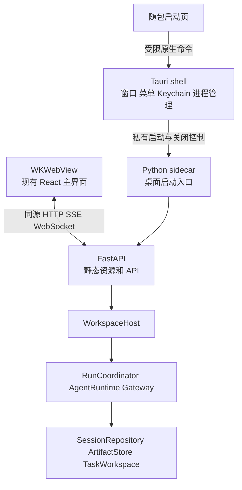

# Lumen macOS Apple Silicon 桌面应用开发实施计划

> 文档复核（2026-10-10）：下文保留计划目标与原始基线；最新完成范围和剩余门禁见[活动计划索引](README.md)，运行行为以源码和当前架构为准。

状态：开源 Beta 代码、本地 arm64 构建及首次配置已交付；真实发行验收待补。计划日期：2026-10-09；状态复核：2026-10-10。

源码交付为 `28d1679`，运行时前置改动为 `7f5e5ce`，Web 前置改动为 `fa0aba3`。
下文保留计划制定时的目标与参考基线；实际完成范围、模拟测试与未完成实机门禁见
[桌面验收](../research/2026-10-09-macos-desktop-validation.md)。本次文档复核未重新执行发行验收。

2026-10-09 范围变更：用户确认没有 Developer ID / Apple 公证账户，目标为 GitHub 开源桌面应用。
本次交付采用 ad-hoc 签名、DMG 和人工升级，不依赖付费 Apple Developer 账户。首次下载可能需要
在系统“隐私与安全性”中明确允许打开；不得关闭 Gatekeeper 或自动清除 quarantine。
下文涉及 Developer ID、公证、Hardened Runtime、updater 的正式发行门禁均转为后续可选路线，
不作为当前开源构建的阻塞。当前 M6 是 ad-hoc app/DMG 构建、架构/签名校验与冻结冒烟；
M7 是 GitHub 只读构建流程、许可证、用户指南和人工升级。不会将 ad-hoc 包描述为 Apple 公证包。
实际实现及验收范围以[桌面指南](../desktop.md)和交付记录为准。

交付目标是在 Apple Silicon Mac 上提供可双击安装和启动的 Lumen 桌面应用。采用 Tauri 2
管理桌面窗口与 Python 后台进程，复用现有 React 界面、FastAPI API 和 Lumen Runtime。
用户无需安装 Python 或 Node.js 即可使用内置功能；用户自行配置的 MCP、命令工具和外部服务
仍可能需要额外程序或账号，应用必须检测并解释这些依赖。

源码参考 HEAD：`291348aa956c88e6ccd6f465fd4ea63656956e7c`。本文同时依据当日工作区中已有的
未提交实现，不能将 HEAD 单独视为完整实现快照。执行 M0 时记录实际 commit、工作区差异摘要、
依赖锁摘要及构建环境。本计划区分代码交付和发行验收，不将现有 Web 能力表述为已通过桌面实机验收。

## 1 产品范围和完成标准

### 1.1 首版支持范围

| 项目 | 决定 |
|---|---|
| 产品名称 | Lumen；安装包为 `Lumen.app` 和 Apple Silicon DMG |
| CPU | 原生 arm64；Rust target 为 `aarch64-apple-darwin`；不依赖 Rosetta |
| 系统 | 初始目标为 macOS 14 及以上；M0 验证后固定支持矩阵，发布前测试最低版本和最新稳定版本 |
| 客户端 | 一个应用实例、一个主窗口、一个活动工作区；可顺序切换工作区 |
| 用户入口 | Finder、Dock、菜单栏；无需终端完成首次配置与必要授权 |
| 核心功能 | 会话、模型与配置、流式输出、工具审批、Plan、文件和工作成果、Agent 结果与导入 |
| 实时语音 | 包含 `live` 依赖，按配置启用；现有两条媒体链路均需验收 |
| 网络 | 本地界面与后台使用 loopback；模型和 MCP 按配置访问外部服务；不承诺完全离线 |
| 发行 | 本次 ad-hoc 签名 Apple Silicon DMG；公开 GitHub Releases 仍需独立授权 |
| 更新 | 本次人工退出后替换应用；自动签名更新作为后续可选项 |

首版不制作 Intel、universal2、Windows、Linux、iOS、Android 或 Mac App Store 版本；不重写
Python Runtime；不引入账号体系、云同步、插件市场、自动下载执行器或新的 Agent 调度系统。
后台驻留只覆盖应用仍在运行时的窗口关闭；不新增 launch agent、开机启动或独立常驻 daemon。

### 1.2 完整交付条件

- 在没有 Python、Node.js、uv、pnpm 和开发者环境变量的干净 Apple Silicon 用户环境中，完成
  DMG 安装、首次配置、项目选择、授权、模型连接和普通会话。
- 现有 Host 客户端契约在桌面版保持有效；审批、工具副作用验证、Agent 导入和终态持久化
  均经过原有运行时权威。
- 文件编辑、取消、崩溃后重载、Live 结束和进程退出有实际结果证据，不能仅以窗口显示成功验收。
- 支持矩阵内的 WKWebView、麦克风、中文输入、文档预览和动态图形均通过签名包测试。
- 整个 `.app` 的 Python、动态库和桌面可执行文件 ad-hoc 签名校验有效；下载后按系统提示明确允许打开。
- 更新不会在活动任务中安装，不覆盖用户数据，不自动降级到不兼容的 Session schema。
- 提供构建说明、桌面用户指南、第三方许可证、发布验收记录和故障排查方法。

## 2 现有基础和需要新增的能力

| 已确认的当前实现 | 入口 | 实施含义 |
|---|---|---|
| Web 生产构建静态导出 | [next.config.ts](../../src/web/next.config.ts) | 保留 Next.js 和 React，应用运行时无需 Next.js 服务 |
| FastAPI 服务静态资源及 API | [app.py](../../src/lumen/api/app.py) | 主窗口采用页面与 API 同源的 loopback 地址 |
| 命令、Session actor、run 和审批集中在 Host | [host.py](../../src/lumen/application/host.py) | 桌面壳不创建另一套任务状态 |
| SSE 使用事件 sequence，Live 有两种媒体实现 | [client.ts](../../src/web/src/lib/api/client.ts)、[realtime-client.ts](../../src/web/src/lib/live/realtime-client.ts) | 复用协议，验证 WebView 中的实际连接和恢复 |
| 启动 token 交换 Cookie，写请求严格校验 Origin | [app.py](../../src/lumen/api/app.py) | 不因嵌入桌面而放宽鉴权和来源检查 |
| CLI 检查项目信任和 MCP 授权 | [cli.py](../../src/lumen/cli.py)、[trust.py](../../src/lumen/trust.py) | 增加桌面交互 Adapter，复用 TrustStore 与 McpApprovalStore |
| 模型密钥按环境变量名解析 | [config.py](../../src/lumen/config.py) | Keychain 值通过受限解析入口提供，保留 CLI 原有行为 |
| Python Plugin 和 Hook 动态导入 | [registry.py](../../src/lumen/tools/registry.py)、[hooks.py](../../src/lumen/hooks.py) | 冻结包需明确支持的模块及依赖范围 |
| macOS 命令 Sandbox 使用 Seatbelt | [sandbox.py](../../src/lumen/sandbox.py) | 在已签名应用内验证沙箱和第三方命令；失败仍拒绝执行 |
| 构建 hook 将 Web 导出包含到 wheel | [hatch_build.py](../../hatch_build.py) | 保留先 Web 构建、再 Python 打包的顺序 |

现有 `lumen web --no-open` 可用于早期验证，但其固定端口、文本启动消息及终端授权不作为正式
桌面启动契约。现有 CLI/TUI/headless 使用方式继续支持，桌面新增能力不得使它们依赖 Rust。

## 3 技术选型

| 层次 | 选型 | 约束 |
|---|---|---|
| 桌面 | Tauri 2 和 Rust | 只管理原生 UI、系统资源、凭据桥接及进程生命周期 |
| 主界面 | 当前 Next.js 15、React 19、TypeScript | 静态导出，复用现有组件和 API 类型 |
| 启动界面 | Tauri 随包内置的小型本地页面 | 在 Host 未就绪时展示项目、配置及授权；复用现有样式，不复制聊天应用 |
| 后台 | 当前 Python Runtime 和 FastAPI | 使用 Python 3.13 的锁定补丁版本，M0 验证 arm64 二进制依赖 |
| Python 分发 | PyInstaller `onedir` | 保持可执行文件与依赖目录关系，不使用启动时解包的 `onefile` |
| 通信 | 现有 HTTP、SSE、WebRTC 和 WebSocket | 主界面与 API 同源；不新建 Runtime IPC 协议 |
| 启动控制 | 桌面壳与后台之间的私有管道 | 仅用于启动授权、凭据供给、就绪和关闭；不接受工具执行或 journal 写入 |
| 凭据 | macOS Keychain | 使用原生 Security API 的现成绑定；不自建加密仓库 |
| 桌面偏好 | Tauri 应用数据目录中的小型 JSON 文件 | 只保存最近项目、窗口位置和显示偏好，严格校验输入 |
| 构建 | Node 22、pnpm 10、uv、固定 Rust stable 和 Cargo.lock | Python 和 Web 沿用当前 lockfile；构建工具隔离且锁版本 |
| 分发和更新 | Tauri bundler；本次人工更新 | 后续 updater 独立采用 HTTPS 和更新签名 |

M0 固定 Tauri、插件、PyInstaller、Rust 和 Python 的确切版本，不以浮动 `latest` 构建发行物。
PyInstaller 是构建依赖，不进入 Lumen 的运行时依赖。Node 和 Rust 只用于开发构建，用户配置
外部 MCP 所需的 Node 不与应用本身的运行要求混淆。

如果 Tauri 在必须支持的媒体或渲染能力上出现难以修复的问题，M0 记录可复现证据并比较
Electron 原型。切换只替换桌面壳，Python Host、HTTP 契约和主 React 界面仍复用；不提前维护
两个桌面实现。Tauri 官方明确支持 Python sidecar 和 Next.js 静态前端，具体用法见
[Sidecar](https://v2.tauri.app/develop/sidecar/) 和
[Next.js 集成](https://v2.tauri.app/start/frontend/nextjs/)。

## 4 架构和职责



### 4.1 状态权威

- WorkspaceHost 持有 session/run、审批、Agent 和 Live 的应用状态。客户端操作进入已有
  Host command/event Interface，不读写内部 `_runs`、coordinator、Plan 或 TaskWorkspace。
- ConfigResolver、现有配置管理 Module、TrustStore 和 McpApprovalStore 继续持有其领域事实。
  桌面窗口只展示请求与提交用户选择；Rust 不直接编辑它们的持久化文件。
- Tauri 只持有窗口、正在管理的进程句柄、启动状态和无业务含义的桌面偏好。
  后台失联时 Rust 可以显示“连接丢失”，不能据此将 run 标为 completed 或 cancelled。
- 启动管道不进入 Session timeline；业务事件仍由 Host 发出，正常 terminal 仍先落盘再发布。
- Tauri capabilities、macOS TCC、Hardened Runtime、Lumen Risk 与 Sandbox 是不同边界。
  获得麦克风或目录权限不等于获得任意工具执行权限。

### 4.2 窗口和工作区

首版一个应用实例只管理一个活动工作区和一个 Python 后台。再次启动只聚焦现有窗口。
关闭主窗口保留应用和活动任务；Dock 点击或菜单“显示 Lumen”恢复窗口。Cmd+Q 进入有序退出。
若有活动 Live，关闭窗口前提供“结束语音并关闭”或“返回”，不能隐藏窗口后继续录音。

切换工作区前检查活动 run、Live、审批和待处理 Agent 导入。运行中默认允许用户保留当前工作区，
或明确取消后切换；不能静默丢弃待处理动作。先关闭旧 Host 并回收它拥有的资源，再启动新 Host。
“最近项目”只是路径列表，不替代项目信任，也不表示用户已经授权读取该目录全部内容。

保留 WorkspaceRunLock。桌面与 CLI/TUI 同时访问同一工作区时，冲突返回现有 busy 契约。
首版不接管未知 CLI Web 进程，不盗用其启动 token，不把用户自己的后台进程纳入桌面清理。

## 5 启动 授权和凭据

### 5.1 启动顺序

1. Tauri 获取应用实例所有权，打开随包启动页；加载窗口和最近项目偏好。
2. 用户选择工作区。确认目录存在、可访问且不是应用包内部目录，解析规范路径。
3. 启动固定位置的 arm64 sidecar，使用参数数组，不调用 shell；建立私有控制管道。
4. Python 使用现有 ConfigResolver 检查配置来源和项目信任。未信任项目只展示待信任的来源；
   在用户选择前不加载项目 Plugin/Hook、执行 MCP 或初始化工作区工具。
5. 用户决定项目信任。Python 调用现有 TrustStore；随后解析配置并请求缺失凭据与 MCP 授权。
   MCP `once` 仅在本次启动有效，`always/deny` 按现有 definition fingerprint 保存。
   配置先经现有严格 schema 解析未插值结构，确定所需变量名，再供给凭据并完成当前解析流程；
   不通过试启动 MCP、Plugin 或模型请求发现缺失凭据。
6. 凭据和授权满足后创建 ResourceManager 与 WorkspaceHost。失败返回脱敏、类型化的错误，
   启动页保留可操作状态，允许编辑配置、重新授权或选择其他项目。
7. Python 绑定 `127.0.0.1:0` 获得系统分配端口，使用同一个已绑定 socket 启动服务，
   避免“探测空闲端口后重新绑定”的竞争。实际端口进入严格 Host allow-list。
8. Host 打开、静态资源可读和服务启动完成后，Python 通过私有通道报告 ready、实际端口及
   一次性启动 token。Tauri 校验进程身份、协议版本和 loopback 地址，再导航主窗口。
9. 复用 `/` 的 token 交换和重定向，移除 URL 中的 token；后续请求沿用 HttpOnly Cookie。
   每次后台重启使用新的 token 和 Cookie，不能重复使用已经消费的 URL。

启动和 MCP 连接有可取消的界面状态，长耗时显示进度与明确原因。启动诊断等待阈值只用于
提示或启动阶段取消，不给主模型 Loop 增加默认重试次数或请求总时限。

### 5.2 私有控制契约

使用有界 JSON 消息、固定协议版本、请求 ID 和明确消息类型；Python 使用严格 Pydantic
验证，Rust 使用严格反序列化。控制通道与 stderr 日志分开，不把可能包含用户正文的任意
stdout 行当作协议。M0 验证 Tauri sidecar 的标准流限制，必要时使用继承的专用 descriptor，
不另起公共网络控制服务。
只有壳与指定后台持有控制通道，工具与 MCP 子进程不继承相关 descriptor，避免壳退出后
通道仍被子进程持有而无法观察 EOF。

消息只包含启动请求、项目信任请求、MCP 授权请求、凭据请求、用户响应、ready、startup_failed
和 shutdown/closed。工作区、授权目标和 fingerprint 必须绑定当前启动请求；重复、过期、
错配和超限响应拒绝。信任确认到实际加载之间重新检查相关输入，变化则重新提示。

bootstrap schema v1 是独立内部协议，不是 Session schema 或配置 schema 升级。
主模型调用、工具参数、Git 操作和 Agent 导入不能通过这个通道绕过 Host。

### 5.3 凭据和首次配置

首次无配置时提供最小模型连接表单：Provider、模型、服务地址、凭据和是否保存。复用当前
配置验证及模型定义，不另建 Provider 目录。只在用户明确保存时创建用户配置，不覆盖现有文件；
配置文件保存环境变量名或既有非敏感字段，Keychain 保存凭据。连接测试是显式网络操作，
配置解析成功不能被展示成模型已可用。

桌面壳读取用户授权的 Keychain 项，通过私有管道供 Python 解析。扩展现有配置中的变量解析
入口，允许传入受限变量 Mapping；CLI 默认继续使用当前环境。桌面 Map 不写入全局
`os.environ`，避免凭据被无关命令或 MCP 自动继承。仅配置明确声明的 MCP env/header
可以得到相应变量；日志、报错、bootstrap、SSE、journal 和 Artifact 摘要不得含值。

Keychain 项由固定应用 service 和用户确认的凭据映射标识。界面只提供设置、替换和删除，
不提供批量读取或明文导出；锁定或访问拒绝时可以重试，不静默退回 YAML 明文保存。
输入表单的短暂密钥值不保存在 React 持久状态、localStorage、URL 或崩溃报告中。

保留 MCP OAuth 的现有 JsonCredentialStore 和 0600 文件语义，验证 OAuth 浏览器回调及
签名应用内的存储路径。首版不迁移已有 OAuth token，不因为引入 Keychain 而改写凭据文件。

### 5.4 外部执行器

Finder 环境与 shell 环境不同，不能靠运行 `.zshrc` 或登录 shell 找工具。提供用户选定的
可执行文件或搜索目录，校验路径后合并到受控 PATH；不执行配置外的 shell 启动脚本。
Apple Silicon 的 `/opt/homebrew/bin` 可作为检测候选，不能作为安装成功的假设。

缺失 `git`、`uvx`、`npx` 或指定 MCP 程序时展示目标、缺失项和配置入口。首版不自动安装
Homebrew、Node 或 Python 包。Python Plugin/Hook 支持随包已有依赖与标准库；依赖未包含
的第三方模块明确报缺失，不在已签名包内执行 pip。复杂插件可改用用户管理的独立 MCP 服务。
Finder 启动环境限制见 [PyInstaller 常见问题](https://pyinstaller.org/en/stable/common-issues-and-pitfalls.html)。

## 6 本地 API和系统安全

主窗口从 Python 提供的 loopback HTTP 地址加载。静态资源、HTTP API、SSE 和媒体 WebSocket
使用同一 origin，保留现有 token、Cookie、Host 与 Origin 校验。不监听 `0.0.0.0`，不增加
通配 CORS，不通过关闭 WebView 安全策略解决兼容问题。

随包启动页可调用少量 Tauri 原生命令；主 loopback 页面默认不获得 shell、通用文件读写或
Keychain 读取能力。项目切换、关于、退出和检查更新先由原生菜单触发。实际必须从主页面
调用的桌面功能才添加窄命令，并验证当前窗口和实际来源；不向任意 localhost 端口开放 IPC。
远程来源访问 Tauri 命令需显式配置，见 [Capabilities](https://v2.tauri.app/security/capabilities/)。

外部 HTTP/HTTPS 链接交给默认浏览器。禁止主窗口导航到外部页面，也禁止不受控新窗口和
危险协议。OAuth 回调仅开放实际需要的路径和来源。文档和模型输出保持当前安全渲染；
从应用包或主页面发出的资源请求配置 CSP，兼容 Next.js 必要脚本并尽量缩小允许项。
HTTP 托管页面的 CSP 必须由服务端响应实际提供，不能假设 Tauri 对远程 URL 自动注入。

后台 token、Cookie 和管道消息不写访问日志、桌面日志或诊断包。诊断导出默认只含版本、
脱敏错误码和用户选择的统计；Session 正文、项目完整路径及用户文件必须显式选择后才附带。
默认不部署遥测收集或自动上传崩溃报告。

保持 SandboxRunner 的 fail-closed 语义。使用真实签名包验证 Seatbelt 的 read/write/network
边界、应用包只读及外部命令动态库路径。不以申请 Full Disk Access 或关闭沙箱作为启动
前置。读取受保护目录遇到 TCC 拒绝时给出具体提示，保留 descriptor/no-follow 安全边界。

## 7 进程生命周期和恢复

| 事件 | 行为 | 验收依据 |
|---|---|---|
| 关闭主窗口 | 应用保留运行；不取消 run；活动 Live 经用户选择结束后才关闭 | 重新打开窗口后可读到当前任务状态 |
| Cmd+Q 且无活动工作 | 请求后台关闭，等待 Host close 与管道 closed，回收所有权明确的资源 | 无遗留 sidecar 或工具进程 |
| Cmd+Q 且有 run/Live | 提供取消并退出或返回；返回则应用和任务继续运行 | terminal 已持久化，Live 连接停止 |
| 切换工作区 | 处理当前任务和导入后，关闭旧 Host，再打开新工作区 | 不同时运行两个写入旧工作区的后台 |
| WebView 刷新 | 保留后台，Cookie 鉴权，重载 snapshot 或续订 SSE | 不重复提交输入，不重新执行工具 |
| 后台退出 | 显示连接中断；允许用户重启并重载 Session | 不自动重放运行或未知副作用 |
| Rust 壳崩溃 | 后台观察私有控制通道关闭并有序清理 | sidecar 不无限驻留，重开可安全恢复 |
| 后台无响应 | 先请求取消与关闭，显示等待；强制退出由用户明确选择 | 保留中断证据，不伪造已完成持久化 |
| 应用更新 | 活动任务及待处理状态解决后有序退出，再替换整个应用 | 无运行中静态资源与后台版本混用 |

进程树清理复用现有执行/Sandbox Seam。Rust 持有具体 Child 句柄，Python 持有自己的工具和
MCP 进程；只结束本次应用拥有的进程，不按命令名扫描或杀进程，不用过期 PID 文件证明所有权。
需要进程组时在启动时建立并验证组身份，不误伤脱离应用管理的用户程序。

优先优雅关闭；诊断等待后允许用户强制结束，不能把超时当成 fsync 已停止。崩溃后按现有
Session 恢复契约加载最后完整批次、标识中断和待核实副作用；损坏 journal 仍严格拒绝，
维修必须由已有显式流程处理。没有持久化的 SSE 内存事件不被描述成重启后可以完整重放。

## 8 打包和用户数据

### 8.1 arm64应用包

在原生 Apple Silicon 环境构建 arm64 Python、依赖和 Rust。先构建 Web，再构建 wheel，
从 wheel 安装到干净构建环境并冻结，确保验证的是实际发行内容而非源码回退路径。
默认包含 `web` 和 `live` extras；`browser`、Crawl4AI 及额外浏览器二进制不随首版分发。
相关功能需明确显示不可用或现有降级能力，不能在后台悄悄下载运行环境。

PyInstaller 采用 `onedir`，按真实引用收集包 metadata、Provider Adapter、动态模块、证书、
builtin skills、静态资源和音频 worklet。避免 `collect-all` 全环境式打包；每个额外收集项
应有运行失败或加载契约依据。

Tauri 的 `externalBin` 只负责可执行文件，不会自动收集 PyInstaller 支撑目录。M0 固定一种
可启动的包布局：可以将完整 onedir 放入 Resources 并由 Rust 用固定资源路径启动；如果
使用 externalBin 搬移主可执行文件，则必须一起映射 `_internal` 并验证重定位后仍可运行。
禁止只拷贝 Python 可执行文件。应用移动到 `/Applications`、含空格目录及其他路径后均需
验证，不能依赖开发机绝对路径、当前目录或 PyInstaller 临时路径。

生产应用只包含一份完整 Web 导出，随 Python 资源提供；Tauri 只嵌入小型启动页，避免将
3D 和视频资产同时嵌入 Rust 又复制到后台。静态资源版本与后台版本一同发布。
目录模式、arm64 和签名选项见 [PyInstaller 使用说明](https://pyinstaller.org/en/stable/usage.html)。

### 8.2 存储位置

| 数据 | 位置和规则 |
|---|---|
| 现有用户配置、项目信任、MCP 授权 | 沿用 `~/.lumen/`；不自动搬迁或覆盖 |
| 工作区 Session、Artifact、worktree 和状态 | 沿用现有 ResourceManager 和工作区存储约定 |
| 模型及用户指定的桌面凭据 | macOS Keychain，用户明确保存 |
| MCP OAuth | 沿用 JsonCredentialStore 的现有路径和权限 |
| 窗口和最近项目偏好 | Tauri 应用数据目录下的版本化 JSON，损坏可重建 |
| 桌面启动日志 | 应用日志目录；有界轮转和脱敏，不复制完整终端环境 |
| 程序、Python库和静态资源 | `.app` 内只读资源，更新时整包替换 |

删除或升级应用不删除工作区、Session、用户配置或 Keychain 项。卸载说明列出可选的用户
清理操作；程序不提供默认“一键清空”工作区数据。配置 schema v2、Session v12 及旧版本
兼容保持原契约；桌面偏好版本独立，不借桌面上线升级 Session schema。

## 9 桌面体验和媒体

复用现有聊天、配置、审批、Plan、工作成果和 Agent 界面。补齐打开项目、最近项目、
显示主窗口、设置、关于、检查更新和退出菜单；遵循 macOS 的 Cmd 快捷键、焦点和窗口行为。
主题跟随现有偏好，窗口尺寸可恢复，缩放或小屏幕不遮挡审批与取消入口。

检查中文拼音输入的 composition 与 Enter、复制粘贴、图片粘贴、拖放、文件上传下载和
文档预览；输入法确认候选不能提交消息。文件选择器授予的路径仍经 Host 的 workspace
解析与附件验证，不能通过原生桥绕过路径、大小、magic signature 或符号链接检查。
基础无障碍包含键盘可达、可见焦点、VoiceOver 标签、动态文字和减少动画偏好。

Live 分别验证 OpenAI direct WebRTC 和百炼 Host PCM WebSocket：首次授权、拒绝后重试、
输入设备切换、打断、断线、结束和应用退出。音频工具调用继续来自可信 Provider Adapter，
不能由浏览器 DataChannel 或原生音频桥执行。

声明 `NSMicrophoneUsageDescription` 并按实测配置必要 entitlement；签名后的包验证
WKWebView 媒体授权及 AudioWorklet。不能因源码 Safari 能录音就判定应用已通过。
Three.js/Rive/透明视频验证渲染、显存、空闲动画及页面隐藏行为；必要时暂停隐藏动画、
限制帧率或使用已有静态角色，不以重写渲染栈作为第一修复。
配置入口见 [Tauri macOS bundle](https://v2.tauri.app/distribute/macos-application-bundle/)。

## 10 实施阶段和阶段门禁

当前已交付开源 Beta 实现与本机验证，真实媒体、最低系统与公开发行验收仍待完成，见
[实施验证记录](../research/2026-10-09-macos-desktop-validation.md)。每个阶段提供可独立审查的代码、契约检查和验收记录；阶段交付
只表示对应切片完成，不自动等同完整应用发行。下列路径是预计改动位置，执行时按真实调用
关系精简，不按表格强行拆文件或新增通用 Interface。

| 阶段 | 交付物 | 前置 | 估算工程日 |
|---|---|---|---|
| M0 | 真实 arm64 技术验证和版本冻结 | 无 | 2–3 |
| M1 | 桌面工程和可复现后台打包 | M0 | 4–6 |
| M2 | 首次配置、授权与 Keychain | M1 | 5–7 |
| M3 | 启动、退出、切换和恢复 | M2 | 4–6 |
| M4 | 桌面体验、媒体和图形兼容 | M1；正式验收依赖 M3 | 4–6 |
| M5 | 安全、数据兼容和集成回归 | M2–M4 | 3–5 |
| M6 | ad-hoc app/DMG、摘要和开源 Beta 验收 | M5 | 3–5 |
| M7 | GitHub 构建、人工升级与发行准备 | M6 | 3–5 |

合计约 28–43 个工程日，单主开发约 6–9 周；这是预算估算，不是排期承诺。Apple 账号、
证书权限、arm64 runner、最低系统测试机、真实 Provider 和外部 MCP 可用性会影响日历时间。
媒体签名 PoC 在 M0 提前进行，避免到 M6 才发现关键能力不兼容。

### M0 固定构建环境并验证关键链路

- 记录实际源码与 lockfile 基线，固定 CPU、macOS、Python、Rust、Tauri 和 PyInstaller 版本。
- 在原生 arm64 Mac 上做最小 Tauri + Python + 现有 Web PoC，跑通鉴权、消息和 SSE。
- 验证 onedir 资源布局、最低系统兼容、stdout 管道污染处理、动态端口和 Cookie 重载。
- 尽早构建带实际发行权限的签名媒体样例，验证 WKWebView 麦克风、WebRTC、PCM/worklet、
  现有透明视频与 Three.js。证书未就绪时继续本地 PoC，但签名媒体门禁保持未完成。
- 在干净环境验证 HTTPS 根证书、Provider 导入、SQLite、静态资源和真实 SandboxRunner。
- 用相同功能确认 Tauri 是否继续；只有出现阻断证据才做 Electron 对照。

门禁：原生 arm64 无 Rosetta；真实静态资源和后台能一起启动；核心媒体问题有明确结果与
处理路径；支持系统、打包布局、工具链和性能预算写入验收记录。M0 不把假界面原型当成应用。

### M1 建立桌面工程和发行后台

- 在 `src/desktop/` 建立 Tauri 工程、启动页、Cargo.lock、图标和最小 capabilities。
- 在 `src/lumen/desktop.py` 建立桌面后台入口与严格启动消息；复用资源装配，不在 Rust 装配 Runtime。
- 新增独立 desktop 构建 dependency group 及冻结 spec，保留 `uv.lock` 和既有 extras 语义。
- 构建 Web → wheel → 干净环境安装 → arm64 onedir → Tauri app 的流水线，加入版本和
  构建清单，确认 CPU、资源和许可证；构建产物不入 Git。
- 将开发运行与打包运行分开：开发允许显式启动源码后台，发行包禁止退回系统 Python。

门禁：任意目录启动或移动应用后仍可运行；无源码 checkout、开发 venv 和 Node 依赖；
静态资源只包含一份；后端导入与证书检查通过；CLI/TUI 不依赖 desktop 工具链。

### M2 完成首次配置 信任和凭据

- 只抽取 CLI 和桌面都需要的配置准入与授权逻辑，保留 CLI prompt Adapter 和非交互拒绝。
- 为启动页实现项目选择、现有配置识别、最小模型配置、错误修复和明确取消。
- 桌面响应复用 TrustStore、MCP fingerprint、once/always/deny，不新增授权文件。
- 接入 Keychain 和受限变量解析，覆盖重新配置、删除、访问拒绝与凭据缺失；敏感信息不进日志。
- 增加外部执行器检测和用户选择路径；验证 MCP OAuth 的既有回调与存储。

门禁：无终端环境可完成首次配置；拒绝信任时无项目代码或 MCP 执行；变更的 MCP 定义
重新授权；授权状态可被 CLI 识别；凭据不会被工具子进程自动继承；已有配置字节不被无故改写。

### M3 完成生命周期 工作区切换和恢复

- 绑定 socket 后就绪通知，启动过程可取消，错误和 stderr 有界脱敏。
- 实现单实例、窗口恢复、关闭窗口继续运行、Cmd+Q 有序退出和工作区顺序切换。
- 通过原有 Host 取消 run 和结束 Live；处理仍有审批、unknown effect 或 Agent 导入的状态。
- 处理管道 EOF、后台异常退出、用户显式重启和进程树清理，不重放未知动作。
- 重载 snapshot 和 Session，验证普通 SSE 断线与整个后台重启是不同恢复路径。

门禁：窗口刷新不重复工具；正常退出任务落盘；壳或后台崩溃后可以显式安全恢复；不结束
无关 CLI/MCP 进程；同工作区冲突仍由 WorkspaceRunLock 处理；旧工作区清理后才启动新工作区。

### M4 完成桌面体验和实际媒体

- 补齐菜单、快捷键、焦点、窗口偏好、主题及初始错误状态，不新增独立聊天界面。
- 验证中文输入、图片/文件操作、文档预览、VoiceOver、缩放和减少动画。
- 验证两条 Live 媒体路径、系统权限、设备切换、打断和退出，保留 Provider 工具权威。
- 验证图形与视频，暂停隐藏动画；只对已证实的兼容性问题添加局部 Adapter。

门禁：核心交互在最低与最新支持系统上可用；实际音频可听、可结束；授权拒绝有恢复路径；
用户输入和文件操作不被原生桥放宽；图形失败能显示现有静态角色而不影响会话。

### M5 完成安全与数据回归

- 测试启动消息严格校验、token 重用、Host/Origin、恶意导航、危险协议和权限范围。
- 在冻结包测试真实 SandboxRunner、命令 Hook、Plugin、Git审批和worktree导入；未知副作用
  保持既有门禁。不要用直接调用内部方法绕过客户端契约来证明桌面操作正确。
- 测试 v1–v11 加载不改写、v12恢复、journal维修、Agent隔离和正常退出落盘。
- 检查所有依赖与 dylib 架构、证书、资源、日志轮转、安装包只读和日志中的测试秘密。
- 完成 Python、Web、Host/API及受影响生成物的回归，记录当前基线中的无关失败。

门禁：无新增未处理的安全/数据失败；实际包的配置、授权、恢复和清理测试通过；不能用
MockTransport 的通过代替真实 Provider、媒体和已签名运行环境验收。

### M6 完成开源发行包和Beta验收

- 固定应用 bundle identifier、版本与所有权信息；bundle identifier 在第一次公开发行后保持稳定。
- 使用 ad-hoc 签名，配置必要麦克风说明；不启用需要 Team ID 的 Library Validation。
- PyInstaller 为冻结 Python 及内层二进制生成 ad-hoc 签名，Tauri 签名完整 app；深层校验只做验证。
- 产出 DMG、SHA256 与构建清单，验证镜像和签名；不执行 Apple 公证或 stapling。
- 在干净用户、最低系统和最新系统中通过实际下载文件完成安装与卸载/重装验证。
- 形成 Beta 验收记录，记录版本、硬件、文件摘要、签名结果和实际媒体/Provider场景。

门禁：安装无需 Python，不自动移除 quarantine 或关闭 Gatekeeper；未公证下载包通过系统
“仍要打开”明确允许。正式 Beta 仍需实际下载安装、重装数据和真实模型、MCP、语音、沙箱验收。
Developer ID、公证和无人干预的 Gatekeeper 通过属于未来具备证书后的可选发行升级。

### M7 完成开源构建和人工升级准备

- GitHub Actions 以只读仓库权限构建 arm64 DMG，上传供审查的 artifact，不自动创建 Release。
- 菜单打开本仓库 Releases；用户退出后下载并替换整个应用，保留配置、Keychain 与项目数据。
- 将 Rust 壳、Python、Web 与资源作为同一版本更新，不在线修补已签名 Python 或静态目录。
- 下载后核对发行摘要，确认系统与架构；应用不可写、安装失败时保留旧版本和数据。
- 禁止自动降级；新版必须能读取发布范围内已有 schema。失败回退只有在数据未发生
  不兼容升级时可人工进行，不把旧二进制直接放回当作恢复策略。
- 完成用户指南、许可证、发布说明、操作手册和最终验收表，准备可审查发行物。

门禁：N→N+1 人工升级在干净用户中保持配置、Keychain、Session、Artifact和信任数据；
无法安全退出时不替换；未完成门禁不得标记正式发布。开发计划和本地生成发行物
不授权提交、推送或公开发布；发行操作按用户授权和仓库发布流程执行。
自动更新未纳入本次开源实现；若以后启用，updater 签名与 Apple 签名分别验证，见
[官方 updater](https://v2.tauri.app/plugin/updater/)。

## 11 预计源码改动和文档

| 位置 | 改动内容 | 原则 |
|---|---|---|
| `src/desktop/` | Tauri、启动页、capabilities、图标、entitlements和偏好 | 作为客户端Adapter，不放Runtime业务 |
| `src/lumen/desktop.py` | 桌面启动、私有消息、socket/关闭装配 | 不复制Loop或另建调度器 |
| `src/lumen/cli.py`和配置准入Module | 共享真实授权逻辑，保留终端交互 | 有第二个调用者才抽取最小函数 |
| `src/lumen/config.py`及config_resolver.py | 可注入的受限变量解析和错误脱敏 | 原有环境变量行为保持默认 |
| `src/lumen/api/app.py` | 实际端口来源、必要CSP及受影响API | 不放宽Origin，不添加桌面专属任务状态 |
| `src/lumen/application/host.py` | 仅在已有命令无法表达必要用户动作时扩展 | 更新共用客户端契约 |
| `src/web/src/` | 必要平台适配、输入和媒体修复 | 复用现有组件，不引入新的前端状态权威 |
| `pyproject.toml`和uv.lock | 独立锁定桌面构建工具 | 可选构建group，不污染运行依赖 |
| `scripts/desktop/` | 后台冻结、app组装和验证入口 | 少量脚本，不建通用发布框架 |
| `.github/workflows/` | arm64构建及受保护发行流程 | 延用现有CI约定，签名密钥不进入PR任务 |
| `tests/`和桌面工程测试 | 新启动协议与风险路径回归 | 复用现有fixture，新增检查应能发现实际失败 |
| `docs/desktop-macos.md`、README和commands | 安装、配置、操作、依赖、恢复和构建说明 | 只在实现后写为当前用户行为 |

实施后更新会话与客户端、配置、安全、实时语音及当前实现审计中受影响的事实，检查 Atlas
手写图解并重建生成内容。若只是此计划文档新增，不改写 Accepted 架构事实，不重建 Atlas。

## 12 验证命令和执行矩阵

### 12.1 代码验证

Python修改先运行相关最小回归，再按根AGENTS要求扩展。预计最小集为CLI、配置、信任、
Host、API、Sandbox与新增desktop测试；运行时/配置/Session改动必须完成全量pytest。

```bash
uv sync --frozen --all-groups --extra web --extra live
uv run --frozen ruff check .
uv run --frozen pyright --pythonplatform Darwin
uv run --frozen --extra web --extra live pytest tests/test_cli.py tests/test_config_resolver.py tests/test_trust.py tests/test_workspace_host.py tests/test_web_api.py tests/test_sandbox.py
uv run --frozen --extra web --extra live pytest
pnpm --dir src/web install --frozen-lockfile
pnpm --dir src/web test
pnpm --dir src/web typecheck
pnpm --dir src/web build
uv build
```

Rust固定工程路径后运行`cargo fmt --check`、`cargo clippy --locked -- -D warnings`和
`cargo test --locked`。新增desktop dependency group、脚本和工作流命令在M1落实后追加到
构建指南；不能把尚未创建的脚本写成已经可运行的验收入口。

改变契约来源后按需运行：

```bash
uv run --frozen python -m lumen.contracts --write
uv run --frozen python -m lumen.contracts --check
pnpm --dir src/web api:schema
pnpm --dir src/web api:schema:check
uv run --frozen python scripts/build_architecture_atlas.py
uv run --frozen python scripts/build_architecture_atlas.py --check
```

`api:schema:check`会重新生成并与Git比较，预期新增schema也会显示差异；需检查差异，不以
删除生成文件或手工修补生成内容消除失败。可选live/web测试命令显式携带extras。

### 12.2 必须覆盖的场景

| 类别 | 场景 | 通过标准 |
|---|---|---|
| 首次启动 | 无配置、无密钥、Keychain锁定、无项目、只读项目 | 有可操作提示；不执行未经授权项目代码 |
| 授权 | 信任拒绝、已信任、MCP once/always/deny、定义变更 | 与CLI语义一致；过期授权不被接受 |
| 配置 | 多Provider、显式配置、项目覆盖、连接地址变化 | 当前解析优先级不变；凭据不泄漏 |
| 工具 | 读取、编辑、命令、结构化Git、Plugin和Hook | 真实Sandbox与Risk门禁有效；输出按原契约 |
| 状态 | 审批、Plan、unknown effect、Agent完成和导入 | Desktop与Web看到同一Host事实 |
| 连接 | Cookie失效、SSE重连、刷新、后台重启 | 不重复提交、不重放未知动作 |
| 生命周期 | 关窗口、重开、Cmd+Q、进程崩溃、切换项目 | 数据可恢复；不遗留自有进程或误杀用户进程 |
| 文件 | 空格/中文路径、符号链接、超限附件、受保护目录 | 验证边界保持；拒绝原因明确 |
| 输入 | 中文IME、快捷键、粘贴图片、拖放和VoiceOver | 候选确认不发送消息；审批可键盘操作 |
| 媒体 | 两种Live路由、拒绝授权、切设备、断线、打断和结束 | 音频及工具完成协议有效；结束后不继续连接计费 |
| 资源 | 无开发环境、移动app、根证书、动态模块和最低系统 | 只用随包内置资源；缺外部依赖不误报成功 |
| 数据 | v1–v11不改写、v12批次恢复、损坏维修和重装 | 不绕过严格校验；不清空用户历史 |
| 发行 | quarantine、arm64、签名、公证、staple与DMG安装 | 默认Gatekeeper可启动；无需开发工具 |
| 更新 | N→N+1、坏签名、断网、忙碌状态、降级和安装失败 | 不安装不可信包，不损坏数据 |

在真实Apple Silicon最低系统和发布当日最新稳定系统验收；至少包含一台M1 8GB和一台
后续代际芯片机器。最低系统的依赖兼容不能只靠`MACOSX_DEPLOYMENT_TARGET`声明；实际
Python/dylib也必须兼容。模拟浏览器、jsdom、HTTP MockTransport和ad-hoc签名分别只是部分证据。

### 12.3 性能口径

M0建立基线并固定预算。初始候选为：无外部MCP连接等待时，冷启动到已鉴权可操作界面p95
不超过5秒，暖启动不超过2秒；M1 8GB上普通聊天静止场景的应用进程树内存目标不超过600MiB。
这些是待测产品目标，不是已实现结果；M0若发现依赖或动态图形成本不满足，应先明确
必要优化与功能取舍再固定预算，不能只提高数字掩盖退化。

记录完整进程树并采用可比的内存指标，区分共享内存，不只测Rust主进程。分别测试静态角色、
动画角色、长会话、流式输出及Live；记录CPU、内存、安装体积和压缩下载体积。启动时钟终点
是后台ready且鉴权完成，外部MCP连接和真实Provider响应耗时单独报告。样本至少30次，保留
median/p95、原始统计及环境；机器相关阈值不作为普通CI的脆弱断言。

不承诺文章中的3.5MB或0.5秒结果，不将Tauri壳的减少外推为Python Runtime性能提升。

## 13 CI 签名和发布

### 13.1 CI分层

普通PR继续现有Python/Web质量检查，增加无发行秘密的Rust检查和arm64冻结冒烟任务。
macOS runner必须明确验证`uname -m`与Python架构为arm64，不能仅凭`macos-latest`标签
假设架构。固定或记录OS镜像，使用实际支持最低系统的构建/测试环境。

发布候选在受保护任务中构建同一源码版本的Web、wheel、sidecar和Tauri app；使用隔离的
临时Keychain导入Developer ID，任务结束清理。证书、公证凭据、updater私钥及真实Provider
密钥由受控Secrets提供；fork PR不能读取，不写进构建清单、日志或测试夹具。

发布依赖顺序：源码与锁定依赖 → Web导出 → wheel → arm64冻结目录 → 资源组装 → 内层
Mach-O签名 → `.app`签名 → DMG/更新归档 → 公证和stapling → 最终文件校验与摘要 → 验收
→ 获授权发布。产物生成后才计算最终摘要，不用签名前hash代表下载文件。

### 13.2 签名策略

对整个Python目录的Mach-O进行清单检查；应用壳、后台和动态库满足对应签名要求。
Hardened Runtime仅开启实测所需entitlement，不默认关闭Library Validation或申请广泛权限。
动态原生插件与内置签名冲突时限定首版支持范围，不能为兼容任意插件整体放宽安全边界。
签名流程见 [Tauri macOS签名](https://v2.tauri.app/distribute/sign/macos/)。

验收命令至少包含实际产物的`file`/`lipo -archs`、`codesign --verify --strict`、
`spctl --assess --type execute`、`xcrun stapler validate`及公证结果读取。
检查嵌套签名应逐一验证，`--deep`可用于验证递归结果但不能代替正确的签名顺序。
公证记录和Gatekeeper结果附入发行验收，失败时保留包与诊断，不通过关闭系统保护继续发行。

### 13.3 发行物

- `Lumen-<version>-macos-arm64.dmg`及最终SHA256。
- 正式版的签名更新归档、updater签名和仅包含arm64平台的更新清单。
- 版本说明、最低系统和外部依赖说明、第三方许可证。
- 私有留存的构建清单、源码版本、lock摘要、签名公证结果和测试记录。

应用版本、Python包版本和静态资源版本由发行流程核对，独立bootstrap版本只描述内部协议。
更新地址和bundle identifier在首次公开发行前固定；不能把开发者个人域名或临时托管地址
硬编码成长期生产入口。Beta和stable使用明确发布渠道，首版不引入服务端动态策略平台。

## 14 风险和应对

| 风险 | 提前检测 | 处理方式 |
|---|---|---|
| WKWebView媒体或图形阻断 | M0签名PoC和M4实机 | 先局部兼容；无法满足必需能力时比较Electron |
| 冻结包缺少动态模块/证书/metadata | M1干净环境和M5导入矩阵 | 依据实际缺项补收集规则，不打包整个开发环境 |
| onedir搬移后资源不可定位 | M0真实app布局和移动测试 | 固定完整资源目录；不只复制externalBin |
| Finder缺执行器或环境变量 | M2无开发环境测试 | Keychain与受控路径选择，缺项明确提示 |
| 首次授权被绕过或确认过期 | M2/M5拒绝和输入变更测试 | Python共享权威复核，严格绑定当前请求 |
| 壳退出后后台或MCP残留 | M3故障注入 | 私有通道EOF、Host清理、所有权明确的进程树回收 |
| 取消时落盘尚未完成 | M3/M5慢I/O和强制退出测试 | 等待真实写入；强制退出记录中断，不能宣布安全关闭 |
| 任意原生插件违反签名要求 | M0/M5签名插件测试 | 标准库/已包含依赖支持，其余使用独立MCP或明确不支持 |
| 新版本无法读取用户数据 | M5/M7schema矩阵与升级测试 | 保留兼容读，禁止自动降级及运行中覆盖 |
| 证书、公证账号或测试机缺失 | M0确认发行资源 | 继续独立开发，正式签名/媒体/发布门禁保持未完成 |

## 15 实施追踪和完成记录

- [x] M0 本机 arm64 构建与 SDK 模拟链路通过，版本与包布局固定；真实媒体与最低系统待验收。
- [x] M1 arm64 工程、内置 Python/Web 与冻结包在隔离 HOME/Finder 环境可运行。
- [x] M2 首次配置、项目信任、MCP 授权和 Keychain 接口已实现；真实 Keychain 跨版本授权待验收。
- [x] M3 窗口、退出、切换、取消与父进程 EOF 清理已实现并验证主要路径。
- [ ] M4 桌面交互、两条Live路径和图形在真实系统通过。
- [x] M5 完整代码回归通过；真实外部工具与发行环境仍依下述验收矩阵执行。
- [x] M6 本机 ad-hoc app/DMG、签名与冻结冒烟通过；下载、最低系统与正式 Beta 验收待完成。
- [x] M7 只读 CI、用户指南、许可证与人工升级路径已交付；公开发行和 N→N+1 实机验收待完成。

实施者在每个阶段追加实际commit、改动位置、运行命令、结果、证据路径和剩余问题。
偏离本计划时解释问题、依据和替代完成条件；实际代码及Accepted决策仍为运行行为权威。
如果桌面实现影响Host/API或配置共享契约，必须同步说明TUI、Web、headless兼容结果。
真实Provider、MCP和媒体的账号与硬件验证单独记录，不用离线测试结果补填“通过”。

## 16 参考依据

- [原始文章](https://mp.weixin.qq.com/s/cvvU940cWXLA_qP8NCDkGg)：选型背景；其中的体积/性能示例不作为Lumen验收数据。
- [Tauri架构](https://v2.tauri.app/concept/architecture/)和[WebView版本](https://v2.tauri.app/reference/webview-versions/)：壳与系统WebView。
- [Sidecar](https://v2.tauri.app/develop/sidecar/)和[Next.js](https://v2.tauri.app/start/frontend/nextjs/)：后台和静态界面集成。
- [Capabilities](https://v2.tauri.app/security/capabilities/)：原生命令访问范围。
- [PyInstaller使用](https://pyinstaller.org/en/stable/usage.html)和[功能说明](https://pyinstaller.org/en/stable/feature-notes.html)：冻结、架构与签名。
- [Apple分发准备](https://developer.apple.com/documentation/Xcode/preparing-your-app-for-distribution)：Hardened Runtime、公证与App Sandbox区别。
- [Tauri签名](https://v2.tauri.app/distribute/sign/macos/)和[Updater](https://v2.tauri.app/plugin/updater/)：发行及更新。
- [会话与客户端](../architecture-guide/05-sessions-events-clients.md)、[工具与安全](../architecture-guide/04-tools-permissions-security.md)、[配置与数据](../architecture-guide/07-configuration-and-data.md)、[实时语音](../architecture-guide/11-realtime-voice-runtime.md)、[长任务恢复](../architecture-guide/14-long-running-recovery.md)：沿用的Lumen契约。
