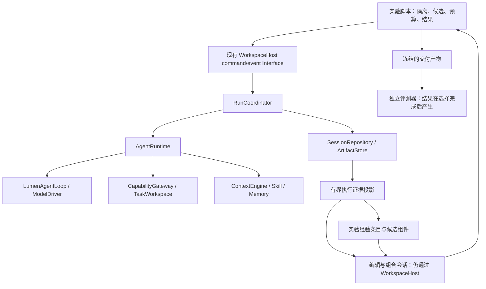

# Agent 效果升级：证据驱动的技能与 Harness 改进实施计划

状态：**Proposed；尚未实施**。设计日期：2026-10-23。

本计划基于 Harness² 研究与 Lumen 当前源码，目标是在可解释的成本下提高复杂任务成功率。
第一批交付是隔离评测、任务验收和经过验证的技能；经验复用与任务级配置优化按效果门禁递进。
计划不替代 Accepted 架构决策，也不把测试通过、模型自评或上游论文分数当作产品效果证明。

本地核对基线为 `7daf2c8e11ae8540065852cad4575a1b27c0a0ba` 加当前未提交工作区，不能只检出该
commit 就认为复现了本次观察。正式实验必须另存实际源文件、依赖锁、任务和配置的内容摘要。
本次只生成设计和计划，未修改运行时代码、调用真实 Provider 或启动实验。

## 1. 决策与目标

**保留既有运行时权威，在它外面建设受控实验，通过实验把有效方法沉淀为技能。**

需要同时改善三个结果：任务确实完成、结果符合要求、为成功付出的总成本可接受。
重点处理输入遗漏、工具误用、口径错误、格式不符、缺少产物复查和长任务约束丢失。
是否存在这些问题及其频率，由本地基线确认；下文例子是待验证假设。

| 决策 | 理由与实施边界 |
| --- | --- |
| 扩展已有 benchmark 入口 | 已有 Host 执行、隔离夹具和文件评分，不另建通用评测平台 |
| 先静态技能与确定性辅助脚本 | 每次任务只付按需使用的成本，改动可人工审查并独立回退 |
| 改进经验先供实验编辑阶段读取 | 经验说明“如何改配置”；用户 Memory 记录偏好和项目知识，两者用途及采用条件不同 |
| 首个自动优化实验只做一次 Propose–Probe–Compose | 固定探索规模，验证增益后才考虑更多轮次或更高并发 |
| 候选池保留基础结果，允许不采用改动 | 生成新配置不等于效果更好；选择失败时必须有明确退路 |
| 有真实任务级检查时复用检查结果 | Runtime 完成、工具执行成功和任务语义正确分别记录 |
| 首期沿用 Session v12、配置 v2 和现有公开工具 | 实验清单独立版本化；不为研究流程增加生产 journal record、公开模式或设置页 |

暂不实施：全局提示词自动改写、生成 Python Hook/Plugin 后加载、自动扩大工具权限、自动安装依赖、
无限递归、多层 child、在线自我训练和每次普通问答后的付费反思。后续需求须有本地失败或实验收益依据。

## 2. 已核对的基础与设计修正

| 当前事实 | 源码依据 | 对设计的影响 |
| --- | --- | --- |
| `trial()` 强制 preset，关闭 Skill、Memory、Hook、MCP | [benchmark_agent_loop.py](../../scripts/benchmark_agent_loop.py) | 保留旧实验语义，增加显式候选输入；不能直接用旧结果评价技能或经验 |
| 临时 workspace 不隔离用户状态 | [resources.py](../../src/lumen/resources.py)、[skills.py](../../src/lumen/skills.py)、[profiles.py](../../src/lumen/agents/profiles.py) | 记忆库、ArtifactStore、用户技能/角色和配置解析必须使用实验专属根目录 |
| `project_trusted=False` 会排除项目 Skill | [resources.py](../../src/lumen/resources.py) | 不能只复制 Skill 到夹具目录并宣称生效；要验证实际模型目录与加载记录 |
| 内置 Skill 默认不启用 | [config.py](../../src/lumen/config.py) | 实验显式选择；发布新增技能保持现有 opt-in 行为 |
| 成功路径 `enrich_usage()` 已合并 child usage | [resources.py](../../src/lumen/resources.py)、[orchestrator.py](../../src/lumen/agents/orchestrator.py) | 顶层汇总不能再加 `child_usage`；失败/取消路径单独核对完整性 |
| 请求有 manifest、诊断和精确指纹 replay | [driver.py](../../src/lumen/agent_loop/driver.py)、[run_diagnostics.py](../../src/lumen/run_diagnostics.py) | 复用证据；换提示词后的质量实验仍需新模型执行，不能套用旧回答 |
| Memory 有来源、作用域、状态、过期和遗忘 | [records.py](../../src/lumen/context/memory/records.py)、[manager.py](../../src/lumen/context/memory/manager.py) | 保留用户记忆权威；不把模型生成的经验交给 `remember()` 冒充显式用户记忆 |
| 本地工具来源标签不证明任务成功 | [resources.py](../../src/lumen/resources.py) 的 `_load_memory_source` | “观察到了失败”也是证据；来源、调用状态和质量改善不可合并成一个 verified 标志 |
| 当前 GC 的持久 live set 来自 Session journal | [session_manager.py](../../src/lumen/context/session_manager.py)、[sessions.py](../../src/lumen/sessions.py) | 实验经验不能只在 Markdown 中引用全局 ArtifactStore，避免被 GC 回收 |
| 文件评分跳过 `.lumen` 等内部目录 | [benchmark_agent_loop.py](../../scripts/benchmark_agent_loop.py) | 额外冻结并校验配置/技能清单，不能让 Agent 改了自己的规则却仍通过范围检查 |

相对前期分析的收敛：**首期不扩展自动记忆学习协议。** 使用现有 Memory 记录一段反思文字很容易，
但要正确支持来源寿命、采用/撤回、产物 GC 和跨任务因果证据，会扩大生产改动。
先将这些证据作为实验产物管理；只有本地验证证明价值后，才设计生产自动采用接口。

## 3. Module、Interface 与数据权威

- **Module / Depth**：沿用 `resources` 装配、`skills` 发现、`context` 预算和 `headless` 执行。
  实验数据与阶段逻辑放在 scripts 范围；只有出现真实第二个调用者才提取共享内部函数。
- **Interface**：实验执行经 Host；多轮夹具用同一 Host 的命令/事件，简单单轮复用 `run_headless`。
  不能直接改 Runtime、Plan、Orchestrator 内部状态来启动或结束阶段。
- **Implementation / Seam**：用户目录是可注入的路径依赖，默认行为不变；不新增“评测版 Runtime”。
  编辑器、执行器、选择器使用相同执行路径，按阶段收窄工具和可见材料。
- **Locality**：实验清单拥有实验阶段状态；SessionRepository 拥有每次实际执行历史。
  阶段清单只引用 run/session 与摘要，不复制一套运行中 turn 状态，也不发布产品 terminal。
- **Leverage**：共享严格契约、Gateway、Sandbox、产物验证和取消/恢复能力。
  “实验递归”是多次独立执行的调度顺序，不改变 child 深度上限。

## 4. 最小实验契约

以下均为待实现的内部文件契约，采用严格 Pydantic、`extra="forbid"`、有界字符串/集合及必要的
`StrEnum`。字段随实际第一种任务冻结；不扩散到 AppConfig、Web API 或通用插件协议。

| 对象 | 最少承载的语义 |
| --- | --- |
| Experiment manifest | schema_version、实际代码/锁文件摘要、任务集与顺序、模型及有效 reasoning、工具/原生能力清单、候选摘要、隔离路径、显式预算、计价依据、各阶段执行引用 |
| BenchmarkTask 扩展 | 兼容现有文本夹具；补充受控任务族、单/多轮输入、可见约束、预期产物定位、可信 `grader_id` 与评分参数；隐藏答案与运行输入分开存储 |
| Harness variant | 基础配置摘要、可选追加指导、选定 Skill 及已审查脚本的内容摘要；受信任务清单选择能力，候选文本不能修改能力 |
| Trial result | runtime_status、task_verdict、各检查项、范围违规、产物摘要、用量覆盖、阶段耗时、模型/配置指纹、不可评分原因 |
| Experience entry | 触发情境、改动假设、候选差异、执行前后观察、反例/限制、源任务和阶段引用、组件摘要；允许空结果，不强制生成经验 |

`runtime_status` 来自持久化运行结果，可为 completed/failed/cancelled/waiting；
`task_verdict` 独立表示 pass/fail/unscored。没有验收器的任务不得因没有报错而被标记 pass。
保留旧输出字段及读取兼容；新报告写明 schema_version，旧报告缺少的指标显示 unknown，不能补零。

验收器由仓库中的固定映射解析 `grader_id`，不接受任务 JSON 或模型生成的 shell/Python 作为评分器。
现有 exact-file 和 substring 检查保留，后者只做弱辅助检查，不能代表研究或文档任务整体正确。

## 5. 实验隔离与候选发布

### 5.1 用户状态隔离先于真实调用

扩展 `ResourceManager` 的内部构造参数，注入一个可选 `home` 路径，默认仍取当前用户 home。
该参数不成为用户配置项。`WorkspaceConfiguration` 已有 `home` 注入，可直接复用。
将同一个值贯穿：

1. 用户配置解析、用户 Skill 发现与动态 refresh、Skill 路径约束。
2. 用户 Agent Profile 发现、Memory SQLite/work queue/Markdown 投影。
3. ArtifactStore、ContextEngine 的 artifact_root、TaskWorkspace/SkillInstaller 的用户路径。
4. 其余实际读取用户数据的装配路径；以哨兵测试确认无遗漏，不仅替换一次 SkillLoader。

每个 trial 有独立 home、workspace、Session 目录和 artifact 索引。不能共享 writable memory DB，
不能用全局 `Path.home` monkeypatch 或修改父进程环境实现并发隔离。需要相同用户记忆的实验，
仅从受审查的无敏感信息快照复制相同初始状态；不读取开发者真实记忆。

隔离路径不是安全沙箱。真实脚本仍走 SandboxRunner；评测器、答案库和其他候选目录保持在
执行器允许读取范围之外。净化配置只保留明确选定模型与必要凭据引用，原生工具、插件、MCP、
Hook、用户技能安装和背景执行逐项禁用或按实验声明配置；不能继承整份用户设置。
凭据不进入清单、日志、产物或编辑器证据；脚本环境继续按既有规则清理。

### 5.2 候选配置的唯一输入

候选技能安装到该 trial 独立 home 的技能目录，处于工作区可写范围之外；实验根配置由可信启动器
构造，保留 `project_trusted=False`。这能使用现有用户 Skill 发现路径，同时避免为了加载技能
信任整个任务目录。候选选择决定哪些内置技能可见，不能误带个人同名覆盖。

模型执行前后检查候选文件、已审查脚本、工具 schema 和有效策略摘要。未知文件、绝对/越界路径、
符号链接逃逸、无效 frontmatter、缺失 helper 或摘要不一致均拒绝进入有效结果。
产物范围评分与候选清单完整性是两项独立检查；不能依赖跳过 `.lumen` 的普通文件 diff。

追加指导使用现有 PromptProfile 能力，不更改 CONTROL_POLICY；执行期间配置固定。
下一次候选使用新的隔离资源实例，避免在运行中热改策略造成结果无法归因。

### 5.3 评分材料与执行证据分离

执行器看到输入和公开任务要求。编辑器看到同一材料、候选文件及实际执行证据。
选择器看到匿名产物和公开约束，不看到候选来源、隐藏答案、分数或排名。
独立评分器在选择完成后读取产物快照，结果只写入受保护报告。

编辑器证据投影保留工具名、实际参数的必要片段、成功/失败、公开结果、产物引用与完成阻塞。
去掉凭据、个人数据、原始私有 reasoning、Provider 私有内容和评分 verdict；大载荷按需读。
不得从内容文本推断来源可信性；使用 Host 持有的 origin、事件 ID 和摘要。
文件隔离之外还要控制网络出口，尤其禁止通过公开 benchmark 站点取得答案；Provider 原生检索
是独立出口，首期确定性任务禁用。在线检索效果另列实验，不能与固定来源离线任务混报。

## 6. 任务验收与技能设计

### 6.1 先验证用户结果

首轮准备 24 个小而真实的任务，分为四族，每族 6 个：来源研究、数据对账、代码修改、长任务/恢复。
按任务模板/来源项目划分开发集与封存集，各 12 个；相同模板改数字不得跨集合。
这些是诊断样本，不是支持小幅收益发布声明的统计样本。

| 任务族 | 执行器可见要求 | 独立验收重点 |
| --- | --- | --- |
| 来源研究 | 提供冻结来源与研究问题，要求引用 | 关键事实与来源对应、矛盾处理、必要覆盖；人工盲审或独立评审补充语义判断 |
| 数据对账 | 多份合成输入与公开输出字段/口径 | 所有输入覆盖、主键/粒度、空值与符号、汇总一致性、源文件未被改写 |
| 代码修改 | 最小可运行项目与问题描述 | 可信外置测试、范围 diff、配置不被修改；测试代码不能由候选替换 |
| 长任务/恢复 | 多轮约束、受控大输出与中断边界 | 恢复后约束保持、完成结果、无重复副作用；固定故障注入必须与模型质量分开统计 |

现有 TaskWorkspace 继续验证 mutation，CompletionGate 继续控制运行时完成。
实验评分结果不回写为历史 terminal，不因评分失败伪造 Runtime failed，也不因评分通过豁免审批
或未知 Effect。面向模型的产物检查必须是当前任务公开要求或真实检查结果。

### 6.2 首批技能由失败记录选定

优先候选为“来源覆盖与引用”“多源数据对账”“产物重新打开与核对”，在基线证实至少两个
独立任务出现对应失败后，选择前两项实施。代码相关流程优先补强现有 test-runner/review-pr。
名称和最终内容随基线冻结，不预先批量创建通用技能库。

每个 Skill 包含可识别的触发条件、必要输入、可执行步骤、公开验收和适用限制；正文按需加载。
Helper 只做确定性操作，先复用已有文件读取/解析能力和标准库；模型负责选择口径，脚本负责计算
与检查。参考知识不能覆盖当前用户要求或当前文件事实。

新增脚本必须按 [Skill 作者契约](../skills/authoring.md) 声明 mapping，使用 `LUMEN_WORKSPACE`
定位输入，不假定 cwd 是任务目录。命令退出成功不等同于产物已验收；检查结果需有真实依据。
需要执行工具的实验显式授权固定能力，保持 `Risk=EXECUTE` 和既有审批；headless 遇确认需求如实
记录拒绝/阻塞。不得把脚本伪装成 read 工具以提高通过率。

以资源装配后的 registry 和 ModelDriverRequest 检查实际可用能力；`skills_enabled` 会单独注册
技能工具，不能只检查配置中的普通工具列表。脚本的审批 Risk 与 EffectKind 分别核对，执行回执
不代表全部文件副作用已捕获；涉及写入时验证实际产物及未解决 Effect 对完成门禁的影响。

脚本验收覆盖空输入、坏格式、路径越界、超大输入和错误退出。涉及子进程的脚本还要验证超时/
取消后的进程树清理；当前 `_run_skill_script` 的 `subprocess.run` 路径不能未经测试视为已满足。
若暴露缺口，修复在既有执行/Sandbox Seam；首批 helper 尽量不创建子进程。

## 7. 改进经验：保存证据，不自动授予权威

实验经验由实验目录内的版本化 manifest 与独立 ArtifactStore 保存。产物包括候选完整文件树、
差异、公开执行证据及使用限制，不能只留一句“下次应该更认真”。
目录按实验、模型/基础配置、任务族和组件版本区分；初期用小型索引按需读取，不先做向量数据库。

每个源任务采用一份不可变经验条目；相同证据摘要重复导入幂等。失败和无效改动可作为反例，
没有新证据时不写条目。“一次观察有帮助”和“可跨任务复用”明确区分，模型 confidence 不控制发布。
任务 t 的编辑器只看 t 之前已冻结的条目；同一任务的候选、重复测量及保留集答案不得泄漏到前缀。
同一次任务优化期间经验库冻结，任务结束后才发布新条目。

经验 manifest 是实验文件的持久根；正文以摘要引用，副本归实验目录所有。首期按整个实验归档/
删除，不调用产品 Session 的 GC 处理这些数据，也不依赖临时 `add_hold()` 实现长期保留。
导出经验时包含引用对象并验证摘要，缺失对象直接标记不可用，不静默使用残缺经验。

实验经验仅供编辑器提案与组合使用，执行器通过新候选技能获得改变。产品 MemoryManager 不在
后台自动接收这些条目。稳定方法经过审查后可以成为版本化 Skill；用户明确要求记住的简短工作流
仍走原有 Memory Interface。若未来自动采用确有增益，再单独设计来源撤回、GC live set、状态迁移
和跨项目隔离，不能把 artifact ref 拼进 content 字符串充当已经实现的持久引用协议。

## 8. 一次受控配置优化

### 8.1 首期可编辑范围

允许调整短的追加指导、Skill 描述/正文，并引用清单内已有、摘要匹配的 helper。
脚本代码由前一阶段人工审查和测试；自动编辑器不能创建/修改可执行文件。
工具集合、参数 schema、Risk、EffectKind、ToolConcurrency、Provider 原生工具、模型配置、
Sandbox、审批规则、完成门禁、Hook/Plugin、预算、依赖和用户配置均不在可编辑范围。
这仍是有效的 Harness 优化实验，暂不覆盖上游全部八种组件。

### 8.2 执行顺序与退出

1. **冻结输入**：记录基础配置、源码、任务、库前缀与能力清单。预算或隔离条件不满足时不发请求。
2. **基础执行**：生成基线产物与证据。公开的确定性验收已经充分满足任务时可直接交付该实验结果；
   不用隐藏评分决定是否继续探索。
3. **两种提案**：通用编辑器关注执行过程，领域编辑器关注当前任务口径；分别从同一基础配置出发，
   必须指出触发观察、预期行为和可能的副作用。无依据返回 KEEP_BASE。
4. **候选验证与探测**：校验允许变更范围、路径、frontmatter、helper 摘要及有效策略；两个合法候选
   分别执行同一任务。完全相同的候选无需再次计作独立发现；复用必须标记，不能伪造重复样本。
5. **组合与执行**：读取全部公开证据，可采用一个候选、组合或保留基础配置。任何未执行的新组合
   都不能成为最终候选。保留基础配置时可复用其已冻结结果。
6. **选择**：候选池含基础结果、两个 probe 和组合结果；仅纳入具有可读产物且满足运行时安全约束的
   执行。匿名化后按公开请求选择已有产物，不合成一个未经执行的新答案。
7. **回退**：选择失败或超预算时，可保留已有合法基础结果并记录原因；没有合法结果则报告失败。
   基础结果进入池不保证选择正确，最终仍由独立评分衡量退化率。
8. **反思**：在选择后依据执行差异生成候选经验，不读取隐藏评分。反思失败不抹去已取得的任务结果，
   也不向库写半成品。之后独立评分，再写研究报告。

首期按顺序执行阶段，避免并发带来的归因与资源问题。并行只是后续性能选项，不引入 child 嵌套。
编辑器同样经 Host 执行，工具只覆盖证据读取和候选目录写入；执行器不能访问编辑器整个工作区。

预算按 **4 个执行会话 + 3 个编辑会话 + 最多 1 个选择会话 + 1 个反思会话** 预估，
单个会话可包含多个模型请求；这是最大名义阶段数，不是 token 或金额的固定倍率。
真实执行必须显式给出每阶段请求/工具/时间预算及实验总预算。沿用既有 Limits 与 Host 取消接口，
预留取消清理时间；预算是实验约束，不给普通 Lumen turn 增加默认硬墙。
现有 Limits 没有累计 token 上限；首期分配请求数和工具调用数额度，用实验计时控制 Host 取消，
token 用于核算。阶段启动前预留剩余额度，额度不足不启动新阶段；取消期间的实际耗时仍须报告。
金额仅作预估与核算，不承诺精确硬上限；即使用量完整，请求中的花费也可能在停止前继续增加。
若后续需要严格金额 admission，须先证明输入/输出额度、辅助请求和重试的保守成本预留可覆盖，
不能把收到最终 usage 后才发现超支称为已防止超支。

### 8.3 重启与失败归属

实验 manifest 原子记录阶段 admission、run/session 引用和完成后的摘要。阶段崩溃后先核对
Session 的持久结果，已完成且摘要匹配的阶段可复用；执行中或副作用未知的阶段标记 interrupted，
不自动重放。人工启动新的隔离尝试时保留旧尝试、已发生用量和失败原因。
拒绝并发写同一实验目录；首期不实现自动分布式重试或跨机器调度。
取消通过 Host，等待真实清理后关闭资源；外层终止不等于子进程已清理，不等于动作回滚。

## 9. 评测指标、成本和采用门槛

### 9.1 指标口径

| 指标 | 口径 |
| --- | --- |
| confirmed task success | 独立验收 pass / 已启动任务尝试；failed/cancelled/waiting/unscored 均保留在分母，并分别列出 |
| grading coverage | 可评分尝试 / 已启动尝试；评分基础设施故障单列，不能冒充模型失败或静默丢弃 |
| false completion | Runtime completed 且独立验收 fail / Runtime completed；unscored 另列 unknown，不能算通过 |
| task quality | 已评分样本的细项分数，必须同时显示样本数、coverage 与完成率 |
| scope/safety violations | 非目标文件改动、候选/策略篡改、越界、审批绕过、重复外部动作，逐项零容忍 |
| delivery latency | 从任务开始至候选采用的墙钟时间，报告 p50/p95；任务后反思耗时另列 |
| full resource cost | 所有成功/失败/取消尝试的执行、编辑、选择、反思、child、压缩及辅助请求；区分已观测、估计、缺失 |
| cost per success | 全部尝试的已核实总成本 / 已确认成功数；成功数为零时不报一个有限值 |
| skill use | 实际目录可见、load_skill、run_skill_script 及其错误；加载率只是诊断，不当成功目标 |

在已安排任务数之外，再报告启动数、预检失败、预算未启动数，避免筛选后才定义总体。
同一输入输出重复产生的实验缓存命中不计作新独立样本。

### 9.2 用量核算

先追踪当前 usage 的包含关系：成功路径 root usage 已含 child 聚合；`agents` 是明细，不能再加。
模型重试用量、缓存 token、同步/后台压缩、错误路径和辅助模型分别建对账用例。
明细定位到阶段与实际执行身份，流式累计更新只取正确增量或最终值，不能把每次 UsageUpdated 相加。
无法确认完整性的情况保持 `usage_complete=false`，缺失不填零。

价格使用实验冻结的 Provider/模型费率和时间，明确缓存命中/写入的计费含义；不使用随日期变化的
隐式在线价格。未知价或缺失用量时保留 token 与金额下界，不用于“更省钱”的结论。
模型版本与费率变更需要新实验 namespace，不可复用旧阶段的成本结论。

### 9.3 对照与采用

按顺序引入实验臂，不一次实现完整矩阵：

| 实验臂 | 与对照的差异 | 目的 |
| --- | --- | --- |
| A 当前 Lumen | 固定基础配置、能力与输入 | 建立基线 |
| B 静态技能/脚本 | 只增加经审查组件 | 验证最低运行成本的改进 |
| C 单次配置优化，无经验库 | 在 B 上增加提案/探测/组合 | 测量任务内探索 |
| D 单次配置优化，有历史经验 | 与 C 相同预算，仅增加合法库前缀 | 测量跨任务改进经验 |
| E 等预算直接执行 | 复用同一基础配置多次执行和相同选择规则，预算匹配 C/D | 区分额外推理与配置改进的贡献 |

同一比较固定 executor、editor、selector、judge 版本、reasoning、工具、初始文件与网络条件。
至少报告三次重复；任务顺序 seed 只控制顺序，不宣称控制 Provider 采样。
跨任务经验做独立有序 stream，库在每个 stream 起点清空；不让一次测量的结果流入另一次基线。
按任务或源项目聚类做配对置信区间，不能把同一任务的多次采样当作多个独立任务。
等预算比较同时报告实际上界、实际花费和超限；不能用相同会话数代替同等计算成本。

24 个诊断样本用于选方向。计划中的推广评估至少覆盖 60 个独立封存任务，每任务重复 3 次，
仍需报告不确定性；样本数本身不保证功效。默认研究目标是成功率提升至少 5 个百分点，且配对
95% 区间下界高于 0；这是预注册的决策目标，不是预期承诺。若区间仍跨 0，保持实验状态，
按事先预算补样或停止，不能边观察结果边改变门槛。

所有采用均要求安全/范围契约零新增失败，各任务族单独检查退化。成本和延迟上限在启动实验前
写入清单，由实际任务价值决定，暂不硬编码一个适合所有任务的倍率。
若 B 已取得相近质量且更低成本，先发布 B。C/D 只有优于等预算 E 且满足成本/延迟上限才进入
受限产品试用讨论。两种 Provider 的复核用于宣称跨 Provider 有效；只测一种时限定结论范围。

## 10. 实施批次与退出条件

依赖顺序为 P0 → P1 → P2 → P3；P4 是采用和交付门禁。P1 可以独立交付用户价值，
后续阶段是否继续由证据决定，不以“全部机制都实现”为目标。不预估未经验证的日历工期。

| 批次 | 具体交付 | 主要影响范围 | 退出条件 |
| --- | --- | --- | --- |
| P0a 状态隔离 | 注入内部 home；贯穿配置、技能/角色 refresh、Memory、Artifact 与 Context 装配 | resources、skills、agents/profiles；复用 configuration.home | 两个实验并发不串状态；真实用户目录只读哨兵未访问/未修改；默认构造兼容 |
| P0b 可信结果 | 扩展 BenchmarkTask/variant/result；冻结清单、隐藏验收、用量对账、持久实验产物 | scripts/benchmark_agent_loop.py、tests/test_loop_benchmark.py | 旧输入/CLI 兼容；waiting/失败/不可评分正确计数；child 不重复计费；dry-run 零 Provider 调用 |
| P1a 任务基线 | 24 个任务、固定可信验收器、开发/封存划分、失败分类 | 计划新增 benchmarks/agent_quality/，基准与测试文件 | 可复现基线；错误结果不会靠“已完成”措辞或空验收通过 |
| P1b 技能切片 | 基于失败选择两项技能，复用/补齐 helper | builtin_skills、docs/skills、相关工具/脚本测试 | A/B 配对报告、实际触发证据、格式与范围检查；成功方法可单独发布 |
| P2 实验证据与经验 | 受控证据投影、组件快照、经验索引、前缀读取、归档 | 计划新增 scripts/harness_experiments.py 及对应测试 | 不读隐藏评分；无证据不入库；跨试验/未来任务不泄漏；引用对象可完整导出和删除 |
| P3 单次配置优化 | 通用/领域提案、双 probe、组合执行、匿名选择、基础回退、显式总预算 | 同一实验脚本，复用 Host/headless/资源装配 | 确定性端到端测试；失败/取消/中断保留事实；真实 C/D/E 对照证明或否定增量 |
| P4 采用与交付 | 发布已验证静态技能；达到门槛后再决定受限在线产品切片 | 文档、包资源、必要的当前架构说明 | 有效果报告、兼容回归、回退说明；在线自动采用另立明确 Host/存储契约后实施 |

建议按表逐批形成可独立审查的改动。P0a/P0b 不夹带策略优化；P1 不依赖经验库完成。
`scripts/harness_experiments.py` 只在 P2 出现真实实验流程时新增，不能先搭框架、注册表和插件体系。
新增 fixtures 与脚本路径目前只是计划，文档不把它们链接为已存在实现。

## 11. 必须覆盖的验证

| 类别 | 最少反例 |
| --- | --- |
| 隔离 | 真实 home 有同名 Skill/角色/记忆；动态 refresh；两个 trial 并发；关闭 learn 后仍有存储初始化；配置刷新回读 |
| 候选准入 | 非法 frontmatter、helper 丢失/篡改、路径/符号链接逃逸、未知文件、试图改权限、执行期间候选改变 |
| 任务评分 | 正确措辞但错误文件；零 grader；只产生部分产物；waiting_for_user；评分进程失败；非法额外修改 |
| 用量 | 父子聚合、同一 child 多 generation、重试、部分流、取消、压缩、重复 usage 事件、未知价格与缓存计费 |
| 经验 | 仅模型自评、失败调用被当成功、重复证据、未来条目泄漏、源文件缺失、别的实验索引可被检索 |
| 选择 | 更漂亮但不符合公开格式的候选；全部候选失败；基础结果更好；选择器异常；选择后产物发生变化 |
| 恢复 | manifest 写入前后崩溃、已完成阶段复用、未知状态不重放、取消阶段子进程、只读探测后不导入真实工作区 |
| 兼容 | 原有 benchmark 参数、Skill 默认发现/覆盖、Memory 禁用与遗忘、Session v1–v12、配置 v1/v2、child 深度与 Gateway 权限 |

先跑相关最小测试。Python 修改运行 Ruff、Pyright 和相关 pytest；涉及资源装配、Context、Memory、
配置或 Agent 生命周期时按仓库约定扩展为全量 pytest。Host/API 有变化时加跑
`tests/test_workspace_host.py` 与 `tests/test_web_api.py` 并检查 Default/Plan/TUI/Web/headless 共用契约。
可选提取/Live 回归显式使用 `--extra web --extra live`；平台范围按 CI 验证，不能用 macOS 测试
代替 Windows 沙箱或安全文件读取证明。

新增内置技能进入 wheel 时执行 `uv build`、隔离 wheel 安装与 CLI 检查，并验证技能/脚本资源实际打包。
涉及事实来源时按正式命令更新 contracts、Provider catalog、OpenAPI 或 Atlas，检查 Atlas 手写图解。
计划文档本身不改变这些事实来源，也不应被 Atlas 的当前事实索引收录。

Mock/TestModel/Replay 证明执行契约；真实 Provider 对照证明模型行为；两种证据分开交付。
固定回答的 Replay 不能用于比较被修改的提示词；“所有测试通过”不能代替 A/B 质量报告。

## 12. 发布、回退与后续边界

初期发布以静态 Skill 为单位，每项关联组件摘要、适用范围和验证报告；内置技能保持 opt-in。
出现回归时恢复上一组件版本或停用该技能，新 Session 使用恢复后的配置；既有 journal 和产物
不改写，失败经验保留为研究证据。普通对话无需等待实验或经验提取服务。

自动优化脚本显式启动、默认 dry-run，不接入普通用户请求、目标推进或后台自动化。
达到 P4 后，如需面向用户提供“额外探索”，再设计预算说明、Host admission、取消与结果发布；
实际副作用仅在正式执行路径发生，不能把多次探测直接用于邮件、远端写入或未知原生动作。

生产自动经验采用属于条件式后续工作：必须定义 MemoryManager 的窄写入 Interface、可信来源
与撤回、幂等、过期、Artifact GC 的持久引用及必要迁移。未经这些契约，不把模型生成内容标记
为 EXPLICIT，也不让使用次数、confidence 或一次选择成功自动晋升为通用规则。

当前保留的完成门禁、权限/Effect 分离、append-only history、子 Agent 深度及未知副作用恢复
契约见 [单一 Loop 决策](../architecture-guide/13-native-agent-loop-migration.md)、
[长任务恢复](../architecture-guide/14-long-running-recovery.md) 和
[工具与安全](../architecture-guide/04-tools-permissions-security.md)。

## 13. 外部证据与完成清单

Harness² 核对版本：`1cfe254e8d25b15f37048c3730134686abe60335`；初次阅读日期 2026-10-22。
本文采用其执行对比、分工提案、组合和经验复用思想，不宣称复现了论文收益。

- [递归执行与名义预算](https://github.com/google-research/harness2/blob/1cfe254e8d25b15f37048c3730134686abe60335/harness2/core/recursion.py)
- [编辑提示与可编辑组件](https://github.com/google-research/harness2/blob/1cfe254e8d25b15f37048c3730134686abe60335/harness2/core/prompts.py)
- [最终选择池与反思](https://github.com/google-research/harness2/blob/1cfe254e8d25b15f37048c3730134686abe60335/harness2/core/selection.py)
- [经验条目与索引](https://github.com/google-research/harness2/blob/1cfe254e8d25b15f37048c3730134686abe60335/harness2/core/library.py)
- [评分分母和不可评分项](https://github.com/google-research/harness2/blob/1cfe254e8d25b15f37048c3730134686abe60335/harness2/core/report.py)
- [复现、网络泄漏与实验边界](https://github.com/google-research/harness2/blob/1cfe254e8d25b15f37048c3730134686abe60335/docs/EXPERIMENTS.md)
- [论文 v1](https://arxiv.org/html/2610.14224v1)

上游框架与第三方 benchmark/数据的许可分别处理；首轮优先自有合成夹具，不引入上游运行依赖。

- [ ] P0 隔离、结果契约和用量对账完成。
- [ ] P1 真实基线与两项技能完成配对验证。
- [ ] P2 经验的来源、前缀隔离、导出/删除得到验证。
- [ ] P3 一次优化及等预算对照完成，包含无收益和退化结果。
- [ ] P4 已采用组件有独立效果报告、兼容检查与回退方式。

以上均未实施。当前交付只检查设计依据、仓库链接、文档差异及生成物影响；未运行模型实验。
