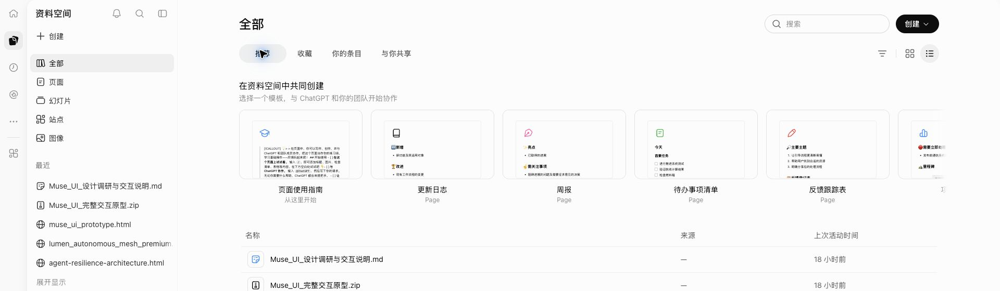
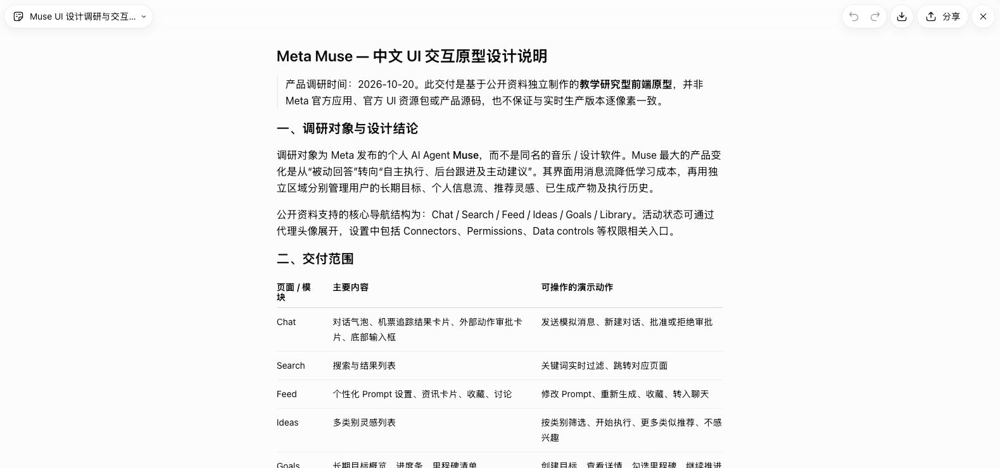
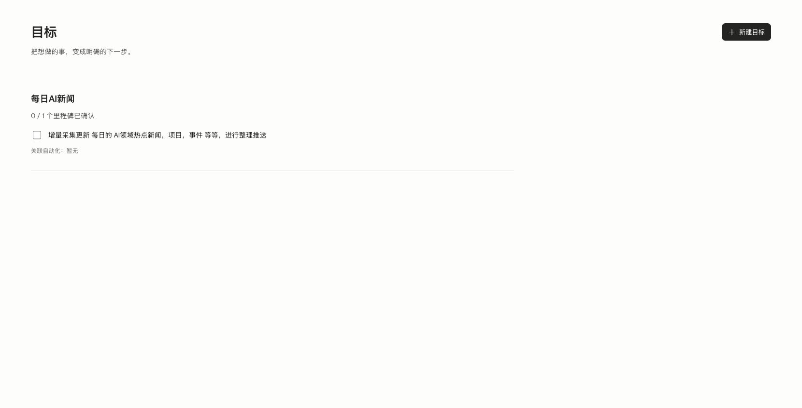
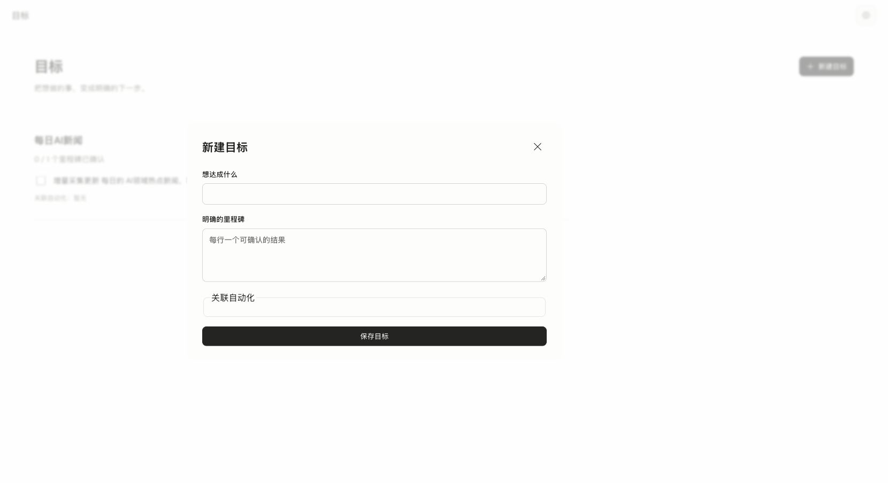
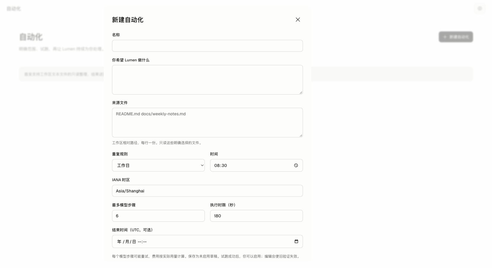
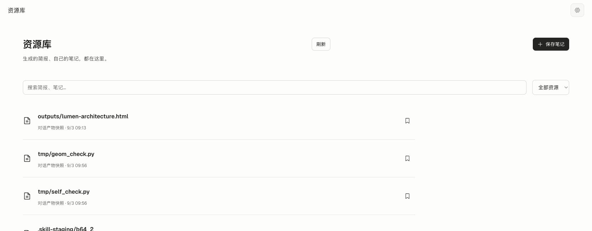

# Muse 与 ChatGPT 资料空间的功能研究及 Lumen 联动审计

日期：2026-10-21。范围：Meta 官方产品与设计资料、ChatGPT 官方 Space 文档、用户截图对应的已登录页面，以及升级前本机 8765 的 Lumen 界面和相关源码。本文保留研究阶段证据；后续落地见[实施验收](2026-10-21-v2-product-flow-validation.md)。

研究阶段结论：Lumen 的菜单之间缺少共同的工作对象与上下文。目标保存后不能直接推进，继续讨论通常只复制文字到新对话，资源库又把执行文件当作交付物收录。应先打通“表达意图 → 推进目标 → 形成内容 → 继续修改 → 持续跟进”，再调整导航。配套[优化实施计划](../plans/2026-10-21-lumen-v2-product-flow-upgrade.md)第 12 节记录后续实现及范围。

## 1 证据等级与来源纠正

| 等级 | 本次采用的证据 | 可证明什么 |
| --- | --- | --- |
| 官方原文 | Meta Newsroom、由其直接链接的 introducing.muse.ai；ChatGPT Learn 的 Space 文档；Claude 原文 | 发布者说明的产品行为和约束，不能证明账号实际可用范围 |
| 当前界面观察 | 已登录 ChatGPT Space；本地 Lumen 8765；截图与可见 DOM | 本次账号和页面实际显示的入口与字段，不外推其他套餐和版本 |
| 当前源码 | Goal、AutomationInput、Resource、Host、Runtime 和 React 页面 | Lumen 真实状态及联动缺口，不以原型替代实现 |
| 旧独立原型（已清理） | 曾提供设计参考和模拟交互；不是 Meta 生产应用；当前以 [Accepted 实现](../architecture-guide/16-personal-assistant-automations.md) 为准 |
| 本文与实施计划的建议 | 从上述事实推导的 Lumen 方案 | 拟采用的设计，不声称属于 Muse 或 ChatGPT |

此前原型说明引用的 `introducing-muse.com` 不再作为本轮权威。此次从 [Meta 官方发布文](https://about.fb.com/news/2026/09/introducing-muse-personal-ai-agent/)的 “How We Designed Muse” 链接实际打开的是 [introducing.muse.ai](https://introducing.muse.ai/)，官方安全文章链接实际落到 [Meta AI Research](https://research.meta.ai/blog/security-and-safety-for-ai-agents-our-approach-with-muse)。本轮不依赖第三方镜像或演示分析来确认产品行为。

本地原型自己明确说明部分流程是推演。它的 Feed Prompt、六项固定导航、模拟连接、航班和审批样例，不能直接升级为官方功能契约。此次可读取的官方资料确认了目标、灵感、活动和丰富产物的设计；没有充分确认原型中 Feed Prompt 的具体交互或全部固定菜单顺序。这里是不作确定断言，不是断言 Muse 没有这些功能。

## 2 Muse 的已核实功能逻辑

官方设计文章说明：主对话可配合主题旁聊；Goals 汇总长期工作及计划，也能回到对话讨论；头像可展开活动及已批准权限；Ideas 根据目标和已知上下文提出建议；Artifacts 可承载适合任务的丰富成果；敏感动作使用明确审批。上述均见 [How We Designed Muse](https://introducing.muse.ai/)。

官方发布文进一步说明，从用户表达目标形成计划，持续工作可在关闭应用后继续，并在有变化或需要审批时返回。它依赖云端专属计算环境；这不等于本地 Lumen 关闭 Host 后也能工作。[Meta 官方发布说明](https://about.fb.com/news/2026/09/introducing-muse-personal-ai-agent/)

由此对 Lumen 的设计推导：

| 设计问题 | 应吸收的逻辑 | Lumen 应怎样落地 |
| --- | --- | --- |
| 用户从哪里开始 | 以想完成的事为入口 | 先说目标或要求，不先选择执行技术 |
| Goals 有什么价值 | 把长期工作的进展和下一步聚合起来 | 目标详情必须可继续工作、看结果、调整跟进，不只显示打勾清单 |
| Ideas 怎么产生价值 | 建议承接已知的目标与上下文 | 开始建议时带上结构化引用和预期成果，而非仅填一句提示词 |
| 如何知道 Agent 在干什么 | 结果与活动各有用途 | 信息流展示值得关注的变化；活动展示运行、排队、失败和控制入口 |
| 为什么需要独立内容对象 | 成果要能持续打开和使用 | 报告、笔记、网页与引用保持稳定 ID，聊天里只是它的入口 |
| 是否删除一切管理功能 | 自然语言入口与明确控制配合 | 收起调度表单，保留可见的暂停、停止、范围和授权检查 |

这些是本项目的设计建议。它们不要求照搬 Muse 的云 VM、并发模型或长期主聊天，也不扩大 Lumen 当前的权限。

## 3 ChatGPT 资料空间的已核实功能逻辑

### 3.1 对象中心与组织层级

官方区分账号／组织 workspace、组织相关页面的 space、可独立存在的 page。Space 聚合页面及其他成果，page 可以含子页面、正文和来源；不是只有上传文件才有内容。[Space 概览](https://learn.chatgpt.com/docs/space)

官方入门流程允许从笔记、文件或现有对话开始，随后在页面旁与 ChatGPT 协作并直接检查结果；内容可按主题分组。重点是持续使用同一份内容。[入门说明](https://learn.chatgpt.com/docs/space/getting-started)

### 3.2 内容与对话双向连接

官方页面文档提供直接编辑、内容块、页面／文件／聊天引用、选中文本后请求修改等方式。引用已有材料不必复制其全文；Prompt 块还可把内容变成下一次讨论的入口。[Pages 文档](https://learn.chatgpt.com/docs/space/pages)

官方 Agent 文档区分页面旁讨论、局部修改、页面内请求和评论中的请求，并强调检查实际修改。它同时明确：Keep Updated 在 launch 时不可用；页面里写更新频率不等于创建了计划任务，要核对保存的时间、启用状态和真实执行。[Work with agents](https://learn.chatgpt.com/docs/space/agents)

### 3.3 分享与来源权限分开

官方文档说明页面／空间可以共享，权限可继承；关联的外部来源仍有自己的访问权限。因此“共享结果”不等于“共享源文件”，更不等于共享私人对话或记忆。[协作文档](https://learn.chatgpt.com/docs/space/collaboration)、[Space 概览](https://learn.chatgpt.com/docs/space)

Lumen 首轮仍是本地单用户，不因此新增团队权限、云端同步或共享按钮。这里吸收的是内容 ID、引用、编辑和组织逻辑。

### 3.4 截图对应账号的实际观察

本次实际访问用户已打开的 `chatgpt.com/space?tab=suggested`，未创建页面、运行模板、发消息或更改分享。

| 观察步骤 | 实际观察 | 证据边界 |
| --- | --- | --- |
| 1 总览 | 全部／页面／幻灯片／站点／图像；推荐／收藏／你的条目／与你共享；搜索、列表／网格和模板入口 | 当前账号的界面，不能推断所有类别在所有账号都可创建 |
| 2 创建菜单 | DOM 可见页面、幻灯片、站台、图像、资料空间、模板、上传文件、连接插件；电子表格显示“即将推出”且禁用 | 菜单已实际展开读取，但截图未保留展开层；不将无菜单的截图作为菜单证据 |
| 3 打开已提供的 Muse Markdown 条目 | 进入内容视图，显示正文、标题、分享及编辑相关控件；DOM 有 contenteditable textbox | 只读观察，没有输入或保存，不证明所有文件类型都能原生编辑或转换 |
| 4 调度入口 | 应用全局导航仍有“定时任务” | 资料空间并未取消调度控制；本轮未创建或修改定时任务 |

对 Lumen 的推导：资料空间应该是内容的工作入口，既能找回成果，也能从内容发起讨论、整理成页面、关联目标。当前只有“生成物列表＋保存笔记”还不足以承担这个角色。没有协作实现时，不复制“与你共享”；没有推荐排序依据时，默认展示“最近”，不复制一个名为推荐的普通文件列表。

## 4 Lumen 当前链路的实际审计

本轮从已有本机页面查看目标、创建表单、自动化表单、资源库与灵感。没有保存目标、启用任务、勾选里程碑、发送提示词或调用模型。下列是当前捕获，未把旧视觉验收截图当作本轮测试。

### 步骤 1 目标概览 缺少推进动作

当前已存在的新闻整理目标，只有里程碑勾选和“关联自动化：暂无”。没有打开目标详情、继续推进、立即执行、关联资料或查看本目标结果的入口。菜单切换成功，但工作在这里中断。

源码对应：[目标渲染](../../src/web/src/components/assistant-workspace.tsx)、[GoalInput](../../src/lumen/automation/models.py)。当前 Goal 只有 title、milestones、automation_ids，加 id／revision；没有主对话、用户意图正文和成果关系。

### 步骤 2 创建目标 要求用户自己提供方案

目标表单没有文件字段，必填的是目标名称和里程碑，并提供关联自动化。因此“目标本身强制选文件”不符合当前契约；更准确的问题是，用户必须自己写计划，保存后仍没有 Agent 推进路径。

后端允许空 milestones，前端却要求填写。这进一步把“帮我规划”变成“先由用户写好规划”。该要求应在新的目标创建流程中取消，保留用户确认里程碑的能力。

### 步骤 3 自动化配置 把执行限制变成通用入口

自动化表单必填来源文件，并展示 IANA 时区、模型步骤和执行时限。它是真实的文件快照整理能力，却不能直接承接“每天帮我收集 AI 新闻”这种需要联网的委托。

[AutomationInput.paths](../../src/lumen/automation/models.py) 至少一份文件；[Host._automation_sources](../../src/lumen/application/host.py) 只准备明确文件快照；[Runtime](../../src/lumen/runtime.py) 对 BackgroundExecution 移除全部工具及原生联网工具。所以只改成可选文件，模型仍不能获取新闻。必须新增可验证的只读检索执行方式。

### 步骤 4 资源库 归档了运行材料但缺少内容工作台

本轮列表前部实际显示报告，也显示临时校验脚本、staging 文件和抓取中间件材料。它们来自 Work Product 索引，不代表用户想保留的成果。分类目前主要是来源种类，缺少资料集合与明确的发布／收录动作。

源码对应：[Store.index_work_products](../../src/lumen/automation/store.py)、[Host._sync_assistant_products](../../src/lumen/application/host.py)。解决办法不是删除这些文件或恢复记录，而是把“执行记录中的文件”和“收录到资料空间的成果”分开投影。

### 步骤 5 灵感与继续讨论 上下文没有稳定身份

灵感有推荐理由、分类与忽略，但开始时调用 `onDiscuss(idea.intent)`。资源继续讨论拼接标题和正文；LumenApp 调用 `leaveSession(); setInput(intent)`。它们可以填入输入框，却不持久绑定原 goal／resource／revision，之后无法可靠聚合成果或回到原工作。

这项判断来自本轮可见入口与[两个 React 组件的调用链](../../src/web/src/components/lumen-app.tsx)，未在用户环境发送测试消息。改进需要结构化引用，不能只优化提示词。

### 可访问性与使用约束

表单已有文字 label、dialog 和关闭操作，是可保留的基础。目标只有 checkbox、非链接的自动化名称，键盘用户同样缺少继续推进入口；计划要求提供明确可聚焦的动作，并在切页和关闭详情时恢复焦点。截图不能证明 WCAG 合规；本轮未做屏幕阅读器、完整键盘、移动端和高倍缩放验收。

## 5 应对齐的产品关系

| 对象 | 回答的问题 | 不应混成什么 |
| --- | --- | --- |
| 对话 | 现在交给 Lumen 什么，如何继续讨论 | 不因创建目标就被迫重新填一套任务配置 |
| 目标 | 想达到什么、下一步是什么、有哪些相关工作 | 不等于文件订阅，也不等于定时器 |
| 一次执行 | 这一次实际做了什么、证据与结果是什么 | 不等于目标已经达成 |
| 持续跟进 | 什么时候再次做、用什么范围、如何暂停 | 不需要成为普通用户必经的低层配置页 |
| 信息流 | 有什么值得我知道或处理的新变化 | 不等于全部日志或未经请求的新闻推荐 |
| 资料空间 | 哪些内容值得保留、组织、修改与复用 | 不等于所有文件副作用的自动清单 |
| 活动 | 正在做什么、排队还是失败、怎样停下 | 不应被移除到用户找不到的技术设置里 |

主导航建议为对话、信息流、灵感、目标、资料空间。持续跟进在目标／内容详情中设定，全部跟进与运行从头像旁活动入口统一检查。低层 AutomationDefinition、CLI 和旧 API 保留兼容；隐藏主菜单不是删除调度权威。

## 6 技术参考与适用范围

Claude 自动化文章的来源、投递、状态、偏好与预算拆分，适合约束后台可靠性；它没有要求所有来源必须是本地文件，也不是面向最终用户的信息架构。Lumen 应保留来源失败可见、投递确认后推进状态和有限权限，不能把参考实现的配置结构直接做成个人助理的主流程。[Claude 原文](https://claude.dev/blog/building-effective-agent-automations/)

本轮不建议引入新工作流平台、云 VM、通用对象图、第二个 Runtime 或完整协同编辑器来修复联动。先沿用既有 Host、Store、Session 与 Resource 完成一个真实端到端切片，工程方案与验收条件见[实施计划](../plans/2026-10-21-lumen-v2-product-flow-upgrade.md)。

## 7 研究边界

Muse 正式应用访问重定向到登录页，未登录操作；设计文章中的部分插图在浏览器中尺寸为 0，未作为可见界面证据。官方产品导览视频未完成播放核验。因此本研究不是 Muse 登录后全流程实测，也不声称复原全部菜单。

ChatGPT 本轮只核查已登录账号的上述视图，没有创建、编辑保存、分享或实际触发 Agent。截图保存了与任务相关的区域；无关个人文件未用于结论。创建菜单的 DOM 观察与未取得展开截图的限制已分别注明。

本次交付为研究与实施计划，业务源码、用户目标和自动化状态未修改，8765 未重启。此前四项代码审查问题仍按[原报告](2026-10-20-v2-code-review.md)跟踪，不因本次产品研究变为已解决。

文档验证：本轮涉及的 10 份 Markdown 共 137 个本地链接及图片引用均存在；Atlas 已通过正式脚本重建并通过 `--check`；`git diff --check` 通过。已核对 Atlas 手写图仍描述现行文件快照范围，没有把 Proposed 流程画成实现。此次没有业务代码变更，未重跑 Python／Web 测试、构建或真实 Provider 执行。
